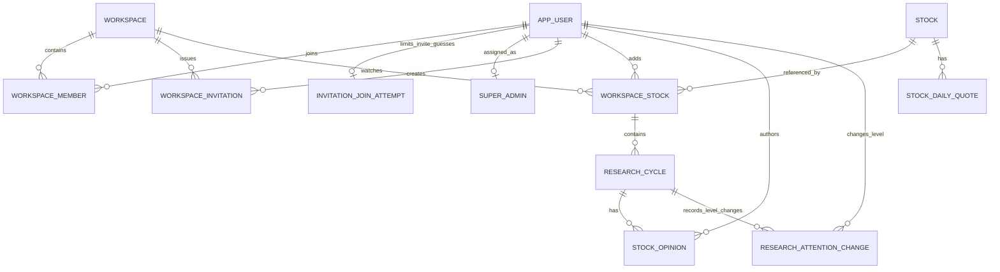

# 基点数据模型

更新时间：2026-10-13

> 结构依据：阶段 1 为 Flyway V1、V2，股票研究首批为 V3，真实股票目录扩展为 V4，研究周期和多人观点扩展为 V5、V6，拼音检索字段为 V7，改密凭据版本为 V8，邀请码试错计数为 V9，关注级别变更事实为 V10。下面 ER 图中的 `STOCK_DAILY_QUOTE` 仅表示后续设计，其余表已有迁移；各环境实际应用版本只见 [状态快照](../project/status.md)，执行前核对现场数据库。

## 1. 设计目标

V11 另放宽用户名检查约束，实施理由见下方 `app_user`；不新增字段或改写账号数据。

数据模型需要同时满足：

- 首批三人家庭能够直接使用；
- 支持多个相互隔离的家庭或研究小组；
- 同一空间内一只股票只保存一份共享关注记录；
- 每个成员可以发表自己的观点；
- 同一个人的观点更新保留时间线，而不是覆盖历史；
- 股票基础信息和行情信息来自系统，不依赖用户手填；
- 后续可以增加评论、提醒和统计，而不推翻核心表结构。

## 2. 核心关系



用一句话理解：

> 用户通过成员关系加入空间；空间共同关注股票；每个成员围绕共享股票发表带时间的个人观点。

## 3. 表设计

### 3.1 `app_user` 用户表

保存登录账号本身，不直接保存用户属于哪个家庭。

已实施字段：

| 字段            | 类型示例     | 说明                                       |
| --------------- | ------------ | ------------------------------------------ |
| `id`            | bigint       | 主键，系统生成                             |
| `username`      | varchar(20)  | 登录账号，清理首尾空白并转为小写，全局唯一 |
| `password_hash` | varchar(100) | 密码摘要                                   |
| `credential_version` | bigint | V8 新增，改密时递增以使旧 JWT 失效 |
| `nickname`      | varchar(20)  | 页面展示名称                               |
| `status`        | varchar(20)  | ACTIVE、DISABLED                           |
| `created_at`    | datetime     | 系统创建时间                               |
| `updated_at`    | datetime     | 系统更新时间                               |

`app_user` 的 V1 原始结构为 7 个字段；V8 因改密后的旧 JWT 失效需求新增 `credential_version`，默认 0。登录账号注册时清理首尾空白并统一转成小写，使用 `unique(username)` 防止重复，V1 产品范围不允许修改账号。字符和长度规则见 [WS-036](../specs/001-workspace/requirements.md#4-已确认规则)；[V11 迁移](../../src/main/resources/db/migration/V11__allow_two_character_username.sql)把原 V1 的 `ck_app_user_username` 下限放宽，不改变字段、唯一性或既有数据。昵称负责页面展示，可以修改；密码只保存摘要，不保存明文。

V1 不实现头像，因此不预留 `avatar_url`；以后真正实现头像时再通过新迁移增加。账号停用与恢复只改变 `status`，治理过程由 `super_admin_operation_log` 保存，不在用户表重复增加停用时间、执行人或原因字段。

### 3.2 `super_admin` 超级管理员表

这张表只负责指出哪个正常用户账号是系统唯一的超级管理员。

| 字段      | 类型示例 | 说明                              |
| --------- | -------- | --------------------------------- |
| `id`      | tinyint  | 唯一管理员位置，固定为 1          |
| `user_id` | bigint   | 指向实际超级管理员的用户 ID，唯一 |

数据库使用主键和检查约束保证 `id = 1`，因此整张表最多只有一条记录。固定的是管理员位置，不是用户 ID；当前登录用户 ID 等于这里的 `user_id` 时，才可以执行超级管理员治理操作。该治理账号及关联由开发者通过默认关闭、无公开入口的一次性初始化器写入数据库，公开注册只能产生普通用户，普通用户不能被提升；`super_admin.user_id` 对应的账号不得出现在 `workspace_member`，也不得成为 `workspace.owner_user_id`。V1 不提供第二名超级管理员或管理员分配页面。

### 3.3 `super_admin_operation_log` 超级管理员操作记录表

这张表只记录唯一超级管理员执行的四类治理操作，不重复保存管理员 ID，因此 ER 图不把它画成具有管理员外键的实体关系。

| 字段            | 类型示例    | 说明                                                             |
| --------------- | ----------- | ---------------------------------------------------------------- |
| `id`            | bigint      | 操作记录主键                                                     |
| `action`        | varchar(30) | DISABLE_USER、RESTORE_USER、ARCHIVE_WORKSPACE、RESTORE_WORKSPACE |
| `target_id`     | bigint      | 被操作的用户或空间 ID，具体类型由 action 决定                    |
| `before_status` | varchar(20) | 操作前状态；无法取得时可空                                       |
| `after_status`  | varchar(20) | 操作后状态；失败且未变化时可空                                   |
| `result`        | varchar(20) | SUCCESS、FAILED                                                  |
| `created_at`    | datetime    | 操作时间                                                         |

V1 不保存管理员 ID、密码、JWT、请求正文、观点正文、操作理由或扩展 JSON。`action` 已经明确目标是用户还是空间，因此不再重复保存 `target_type`。

### 3.4 `workspace` 研究空间表

代表一个家庭或小型投资研究组。

空间使用 `owner_user_id` 表达唯一当前所有者，成员表不重复保存 `role`。该设计把所有权保留为单一事实来源，转让时锁定空间行并只更新一个字段；当前业务没有多个管理员、编辑者或观察者，不为了展示复杂度提前引入成员角色列。

`workspace` 只保留本阶段具有明确业务用途的 7 个字段。V1 不用简介填充页面，也不机械增加无法表达具体变更事件的通用更新时间。

| 字段                 | 类型示例                        | 说明                                                |
| -------------------- | ------------------------------- | --------------------------------------------------- |
| `id`                 | bigint                          | 主键                                                |
| `name`               | varchar(30) COLLATE utf8mb4_bin | 删除 Unicode 空白后的空间名称，精确区分大小写和标点 |
| `created_by_user_id` | bigint                          | 最初创建者用户 ID，创建后不变                       |
| `owner_user_id`      | bigint                          | 当前所有者用户 ID，可以转让                         |
| `status`             | varchar(30)                     | ACTIVE、ARCHIVED_BY_OWNER、ARCHIVED_BY_SUPER_ADMIN  |
| `archived_at`        | datetime                        | 当前归档时间，活动状态为空                          |
| `created_at`         | datetime                        | 系统创建时间                                        |

空间名称保存前由后端删除 Unicode 空白字符，清理后必须为 1～30 个字符，数据库直接保存清理后的名称，不增加重复的 `name_key` 或 `normalized_name`。`unique(name)` 负责全平台唯一，并在并发创建同名空间时提供最终保护；数据库重复错误由后端转换为“该空间名称已被使用”的业务提示。页面可以按布局省略显示长名称，但不能改变数据库中的真实名称。

V1 不保存 `description`。当前简介不参与权限、搜索、邀请、成员治理或归档流程，首批小型研究组也没有不可替代的说明场景；空间卡片与概览应使用成员数量、创建者、创建时间等真实信息，而不是为了视觉填充增加低价值输入。以后真实用户需要区分多个相近空间时，再通过新 Flyway 迁移增加简介字段。

V1 不保存 `workspace.updated_at`。名称、所有权和归档状态共用一个最后更新时间只能说明空间“变过”，不能回答由谁修改、哪个字段变化或前后值；当前也没有展示、最近修改排序、增量同步、缓存失效或乐观锁需求。`created_at` 保存空间创建时间且创建后不变，`archived_at` 保存当前这次归档时间并在恢复时清空。该决定只适用于 `workspace`，其他表是否需要 `updated_at` 由各自业务用途决定。

`status` 同时表达当前是否归档以及合法恢复入口：`ARCHIVED_BY_OWNER` 只能由当前 OWNER 恢复，`ARCHIVED_BY_SUPER_ADMIN` 只能由唯一超级管理员恢复。`archived_at` 只保存当前这次归档时间，恢复为 `ACTIVE` 时清空。V1 不重复保存 `archived_by_user_id` 或 `archive_source`：OWNER 归档者由 `owner_user_id` 确定，超级管理员唯一且治理操作另有操作记录；未来确需完整状态历史时再建立事件表。

### 3.5 `workspace_member` 空间成员表

连接用户与空间，是多空间和权限设计的核心。

| 字段               | 类型示例    | 说明                         |
| ------------------ | ----------- | ---------------------------- |
| `id`               | bigint      | 主键                         |
| `workspace_id`     | bigint      | 空间 ID                      |
| `user_id`          | bigint      | 用户 ID                      |
| `status`           | varchar(20) | ACTIVE、LEFT、REMOVED        |
| `first_joined_at`  | datetime    | 第一次加入时间               |
| `last_joined_at`   | datetime    | 最近一次加入时间             |
| `last_inactive_at` | datetime    | 最近一次退出或移除时间，可空 |

重要约束：

```text
unique(workspace_id, user_id)
```

同一个用户与同一个空间只保留一条成员关系；退出、移除和重新加入都更新这条记录，不重复插入。

成员表不再重复保存 `OWNER/MEMBER`。`OWNER` 本身也必须有一条 `ACTIVE` 成员记录：有效成员的用户 ID 等于 `workspace.owner_user_id` 时，对外身份标签为 `OWNER`，其余有效成员的标签为 `MEMBER`，同一用户在同一空间同一时刻只显示一个标签。退出、移除和重新加入复用同一条成员记录，历史观点不随成员状态删除。

`first_joined_at` 永远保存首次加入时间，`last_joined_at` 在合法重新加入时更新，`last_inactive_at` 在主动退出或被移除时更新。被移除者重新加入时，只需用当前 `status = REMOVED` 和 `last_inactive_at` 判断邀请码是否在移除后生成，因此不重复保存 `last_inactive_reason`；V1 也不展示历史移除执行人，不保存 `last_inactive_by_user_id`。成员关系只有这些生命周期变化，所以不再机械增加与上述时间重复的 `created_at/updated_at`；未来确需完整进出历史时再建立成员事件表。

### 3.6 `workspace_invitation` 空间邀请表

邀请码不是为了三个人制造复杂度，而是提供一种不需要管理员手工改数据库的安全加入方式。

V1 固定每个邀请码最多成功加入 5 人，不在每条记录重复保存这个固定值；表内只保存并发计数、明确撤销状态和计算有效性所需的数据。

| 字段                  | 类型示例      | 说明                                                      |
| --------------------- | ------------- | --------------------------------------------------------- |
| `id`                  | bigint        | 主键                                                      |
| `workspace_id`        | bigint        | 邀请加入的空间                                            |
| `invite_code`         | char(6)       | 安全随机生成的 6 位大写英文字母或数字，数据库直接保存明文 |
| `created_by_user_id`  | bigint        | 创建邀请码的用户                                          |
| `expires_at`          | datetime      | 过期时间                                                  |
| `used_count`          | int           | 已成功加入的人数，初始为 0，范围为 0～5                   |
| `status`              | varchar(20)   | ACTIVE、REVOKED；过期和用尽动态判断                       |
| `created_at`          | datetime      | 创建时间                                                  |
| `active_workspace_id` | bigint 生成列 | 持久化状态为 ACTIVE 时等于空间 ID，否则为空，用于唯一约束 |

V1 邀请码使用安全随机数生成 6 位大写英文字母或数字，数据库直接以 `invite_code` 保存明文；`unique(invite_code)` 防止重复，碰撞时重新生成。固定上限 5 是统一业务规则，数据库检查 `used_count` 处于 0～5，当前没有逐邀请配置上限的需求，因此不保存永远等于 5 的 `max_uses`；以后出现真实的可配置需求时再新增字段。

邀请记录只持久化 `ACTIVE/REVOKED`。接口状态按 `REVOKED`、`used_count >= 5`、`expires_at` 的顺序计算为 `REVOKED/EXHAUSTED/EXPIRED/ACTIVE`，无需定时任务把自然过期或用尽写回数据库。`active_workspace_id` 在持久化状态为 `ACTIVE` 时等于 `workspace_id`，否则为 `NULL`；唯一索引利用 MySQL 允许多个 `NULL` 的规则，保证一个空间最多一条未撤销邀请。生成新邀请码的事务先锁定空间并把旧的 `ACTIVE` 记录改为 `REVOKED`，再插入新记录，因此已经自然过期或用尽的旧记录不会阻止重新生成。

该决定将邀请码视为短期加入凭证而不是密码，接受数据库读取者可以看见明文的代价；接口仍必须要求登录并检查有效性；连续错误尝试限制统一见 [SPEC-001 失败边界](../specs/001-workspace/requirements.md#8-必须覆盖的失败情况)。只有当前 `OWNER` 的当前邀请管理响应可以返回完整代码；普通成员、超级管理员和历史邀请响应不返回完整明文，日志、异常和治理操作记录不得记录邀请码。使用时通过数据库行锁串行检查和增加次数，已是有效成员不消耗次数，被移除者只能使用创建时间严格晚于最近移除时间的新邀请。两侧时间都以 `DATETIME(3)` 保存；生成事务已持有空间行锁，因此可读取当前被移除成员的最晚失效时间，并在同毫秒时把新邀请创建时间推进 1 毫秒，不能把判断放宽成“大于等于”。

V9 的 `invitation_join_attempt` 只保存 `user_id` 主键兼外键、`failure_count` 和 `window_started_at`；不保存用户输入的代码或 IP。固定窗口与额度属于加入接口规则，见 [SPEC-001 设计](../specs/001-workspace/design.md#731-邀请码连续错误尝试)。计数通过唯一键和行锁串行化，成功时删除，过期时懒重置，账号删除时级联清理。

### 3.7 `stock` 股票基础信息表

> 阶段边界：3.7～3.10 的首批字段已经由 [V3 迁移](../../src/main/resources/db/migration/V3__create_stock_research_tables.sql) 固化，当前实现方案见 [SPEC-002](../specs/002-stock-research/design.md)。本节只保存跨阶段稳定的数据职责，不重复迁移中的完整字段表；3.11 仍待后续闭环设计。

`stock` 保存全系统共享的沪、深、北 A 股及港股标准身份和基础信息。真实目录模式通过本地表搜索，模拟模式仍由 Mock 提供候选；用户不能自由提交名称、交易所或币种。标准代码含市场后缀并全局唯一。V4 扩展 BSE 交易所和 UNKNOWN 状态，并增加实际用于繁体/英文搜索的 `search_aliases` 与同步追溯的 `last_synced_at`；V7 增加由可信目录名称离线生成、只用于搜索召回的 ASCII 小写 `pinyin_initials`。当前 `stock` 只保留 `id` 主键索引和 `code` 唯一二级索引，不为 `pinyin_initials` 新增索引：现有 8318 条目录的综合搜索虽经执行计划确认全表扫描，但本机单次只读实测约 6.11 毫秒，尚无实际延迟问题；数据规模或页面延迟明显变化时再重新测量，不能把该本机数字当作生产承诺。精确定义见 [V4 迁移](../../src/main/resources/db/migration/V4__support_real_stock_directory.sql)和 [V7 迁移](../../src/main/resources/db/migration/V7__add_stock_pinyin_initials.sql)。

UNKNOWN 表示尚未取得可信的交易状态，不代表停牌或退市。目录导入保留既有已核实状态，原 Mock 状态不能当真实事实沿用；缺失股票不删除、不自动退市。既有股票 ID 和研究外键保持稳定。目录搜索与报价相互独立：只读目录模式也能搜索，但新研究周期仍须取得可信行情并遵守 [V1 未退市核验规则](../product/requirements-v1.md#33-共享自选股与行情)；当前只允许 LISTED 与 SUSPENDED 开启研究，DELISTED、UNKNOWN 及状态核验失败均拒绝。

### 3.8 `workspace_stock` 空间共享股票表

`workspace_stock` 保存某个空间与某只标准股票的长期共享关系。`(workspace_id, stock_id)` 唯一，因此结束关注和重新关注不会创建第二份空间股票身份；关注状态、开始价格和结束时间不放在这里，而属于具体研究周期。

### 3.9 `research_cycle` 研究周期表

`research_cycle` 保存一段关注过程，包括所属共享股票、关注级别、开始人和时间、开始时的行情快照，以及以后需要的结束信息。同一 `workspace_stock` 同时最多有一个活动周期，由数据库唯一约束兜底。结束后重新关注会插入新周期，旧周期保持历史状态。

### 3.10 `stock_opinion` 成员观点表

`stock_opinion` 保存每次观点发表或更新，必须关联明确的 `research_cycle`，作者和创建时间由后端产生。初始添加写入 `INITIAL`，后续观点使用 `UPDATE`，复盘使用 `REVIEW`；任何更新都新增记录，不覆盖旧观点。V5 增加 `withdrawn_at` 与 `withdrawn_by_user_id`，两者必须同时为空或同时有值。V6 将倾向统一为 `BULLISH/NEUTRAL/BEARISH`，把必填的 `risk_note` 改为可空的 `observation_note`，并允许周期进入 `CANCELLED`。作者仅能在发表后 5 分钟内撤销活动周期中的内容；撤销初始观点会取消周期，撤销后续内容只隐藏该行正文，均不物理删除。

为什么不直接在自选股表上保存一列 `note`：

- 一列备注无法区分是谁写的；
- 后来修改会覆盖最初观点；
- 无法展示观点随时间变化；
- 无法比较不同成员的判断。

观点使用独立表后，可以自然形成：

```text
2026-08-04 你：初始看多，理由 A
2026-08-10 家人甲：看空，观察条件 B
2026-09-01 你：更新观点，目标价变化
```

### 3.11 `stock_daily_quote` 股票日行情表

`stock_daily_quote` 用于后续需要长期保存的日行情、关注以来表现和历史复盘，计划同一股票同一交易日最多一条日行情；它仍未创建。当前 K 线和分时从 Longbridge 按需取得，并可由 Redis 与进程内缓存复用，具体缓存机制见 [SPEC-002 设计](../specs/002-stock-research/design.md#46-redis-共享行情缓存与访问保护)。动态序列不会写入 `stock` 或 `research_cycle`，首个闭环只把开始时的最新可用报价快照保存在 `research_cycle`。Redis 数据可过期、丢失或重建，不能替代需要长期复盘的数据库事实；真正落库前仍要确认字段、复权口径和幂等写入规则。

### 3.12 `research_attention_change` 关注级别变更表

V10 只保存无法由当前周期状态还原的普通／重点关注切换：`research_cycle_id`、操作人、切换前后级别和时间。外键连到研究周期与账号；检查约束禁止两级相同，重复提交不写入。首次加入、重新关注、观点发表与撤销、周期结束／取消仍由现有周期和观点事实还原为近期动态，不复制观点正文或另建全量活动表。V10 前已发生的级别切换没有历史记录，不能从当前值倒推或伪造。详情见 [SPEC-002 设计](../specs/002-stock-research/design.md#64-已确认-v1-能力的设计入口与落地)。

### 3.13 V2 个人助手记录与费用账本

[V13](../../src/main/resources/db/migration/V13__create_research_agent_records.sql) 建立四张表，不插入演示数据或凭据：

| 表 | 职责与约束 |
| --- | --- |
| `agent_session` | 用户＋空间＋空间股票＋周期唯一；`context_version` 防止清空后迟到结果恢复。外键保证对象存在，实际归属和当前成员权限仍由业务层校验 |
| `agent_message` | 仅保存已校验成功的结果与本次完整资料依赖；`run_id` 唯一。同一会话按运行 ID 有界读取，每页 6 条。清空删除正文与引用快照 |
| `agent_run` | 同一用户的 requestId 唯一，另存对象／条件摘要校验重复请求；记录状态、开始／结束时间、模型／提示词版本、派发标记、Token 和费用占用。没有完整提示词、思考内容或账号凭据；清空保留必要账本 |
| `agent_budget` | 唯一行累计已结算的费用上界与未结算预留。调用准入在短事务里锁此行，统一检查预算、每用户一轮和总并发两轮；不是供应商账户余额 |

共享观点正文仍以 `stock_opinion` 为原文入口。历史回答恢复前核对全部输入依赖；撤回使整个依赖回答失效，无权限不返回个人正文。清空按当前用户和对象删除消息并增加版本，不删除共享观点或重置费用。网络调用发生在事务外，保存与清空采用一致的预算行→会话行锁顺序。具体流程和费用口径见 [SPEC-004 设计第 5、6 节](../specs/004-research-agent/design.md#5-调用费用和失败限制)。环境应用状态只见 status。

[V14](../../src/main/resources/db/migration/V14__track_agent_model_and_tool_calls.sql) 只给 `agent_run` 增加 `model_calls`、`tool_calls` 和 `tool_trace_json`。前者记录实际 HTTP 派发，后者记录模型工具尝试，轨迹仅含工具名／完成或失败／耗时，不保存参数正文。旧运行默认 0 表示此前没有此统计，不能据此说旧运行没有调用。每轮 Token 为所有已知响应之和；任何派发用量未知仍保留整轮预留，清空不改变它。

`agent_message.answer_json` 兼容旧固定梳理，并增加 `followUp`（问题、段落／引用、缺口、行情依据、历史省略标记）。`sources_json` 兼容旧单快照，追问使用有界快照列表保存实际依赖；模型上下文只继承当前仍有效且同筛选的历史，主快照覆盖其观点依赖。行情依据保存生成时实际取得的 QUOTE／DAILY_PRICES 快照，查看时重新授权，不把它存入全局股票行情表。

## 4. 阶段 1 约束与索引终审

V2 的个人助手关系见第 3.13 节，不改变下列共享空间和研究事实约束。

### 4.1 主键策略

- `app_user`、`super_admin_operation_log`、`workspace`、`workspace_member`、`workspace_invitation` 使用 `BIGINT UNSIGNED AUTO_INCREMENT` 主键，Java 映射为 `Long`，MyBatis-Plus 使用 `IdType.AUTO`；
- `super_admin.id` 是表达唯一管理员位置的 `TINYINT UNSIGNED` 固定值 1，不使用自增；
- 当前只有一个模块化单体和一个 MySQL 主库，数据库自增主键已经能无冲突地产生 ID，因此不使用雪花 ID。雪花 ID 解决的是多个节点或多个数据库不能共同依赖一个自增序列的问题，当前引入只会增加节点编号、时钟回拨和长 ID 排查成本；
- 递增 ID 不能被当作权限边界。所有带空间 ID、成员 ID 或邀请 ID 的接口仍必须验证当前用户，不能因为攻击者猜到相邻 ID 就返回数据。

### 4.2 唯一约束

| 表                     | 唯一约束                  | 防止的问题                         |
| ---------------------- | ------------------------- | ---------------------------------- |
| `app_user`             | `username`                | 两个账号使用同一登录名             |
| `super_admin`          | `user_id`                 | 同一用户重复占用管理员关联         |
| `workspace`            | `name`                    | 全平台空间重名和并发重复创建       |
| `workspace_member`     | `(workspace_id, user_id)` | 同一用户在同一空间出现两条成员关系 |
| `workspace_invitation` | `invite_code`             | 两条邀请使用相同代码               |
| `workspace_invitation` | `active_workspace_id`     | 同一空间出现两条未撤销邀请         |

### 4.3 检查约束

- `app_user`：用户名检查约束已由 V11 放宽，规则见 WS-036；昵称清理后长度为 1～20；`status` 只允许 `ACTIVE/DISABLED`；
- `super_admin`：`id = 1`；
- `super_admin_operation_log`：`action` 只允许 `DISABLE_USER/RESTORE_USER/ARCHIVE_WORKSPACE/RESTORE_WORKSPACE`，`result` 只允许 `SUCCESS/FAILED`；
- `workspace`：名称长度为 1～30；`status` 只允许 `ACTIVE/ARCHIVED_BY_OWNER/ARCHIVED_BY_SUPER_ADMIN`；`ACTIVE` 时 `archived_at` 必须为空，归档状态时必须有值；
- `workspace_member`：`status` 只允许 `ACTIVE/LEFT/REMOVED`；`first_joined_at <= last_joined_at`；`LEFT/REMOVED` 时 `last_inactive_at` 必须有值且不早于首次加入时间，重新成为 `ACTIVE` 后允许保留上一次失效时间；
- `workspace_invitation`：`invite_code` 必须是 6 位大写英文字母或数字；`used_count` 处于 0～5；`status` 只允许 `ACTIVE/REVOKED`；`expires_at > created_at`。

详细输入清理和业务提示仍由后端完成，数据库检查约束负责拒绝明显不可能的最终状态，不能替代 RequestDTO 校验和 Service 业务判断。

### 4.4 外键与更新删除规则

以下关系建立外键：

```text
super_admin.user_id                       -> app_user.id
workspace.created_by_user_id              -> app_user.id
workspace.owner_user_id                   -> app_user.id
workspace_member.workspace_id             -> workspace.id
workspace_member.user_id                  -> app_user.id
workspace_invitation.workspace_id         -> workspace.id
workspace_invitation.created_by_user_id   -> app_user.id
```

以上外键统一使用 `ON DELETE RESTRICT ON UPDATE RESTRICT`。账号和空间通过状态停用或归档，不物理删除；存在引用时拒绝删除比级联清除成员、邀请和历史更符合数据保留规则。主键作为稳定标识也不允许级联修改。

`super_admin_operation_log.target_id` 不建立外键：同一列会按 `action` 指向 `app_user` 或 `workspace`，数据库外键不能让一列同时引用两张表；治理日志还需要独立保留。数据库也不能用普通外键直接保证 OWNER 同时是 ACTIVE 成员，或保证 SUPER_ADMIN 不成为空间成员和所有者，这两条跨表规则由 Service 事务、空间行锁和集成测试保证，不使用触发器或循环外键。

### 4.5 查询索引

| 表                          | 索引                              | 对应查询                     |
| --------------------------- | --------------------------------- | ---------------------------- |
| `app_user`                  | `(status, created_at, id)`        | 超级管理员按状态分页查看账号 |
| `super_admin_operation_log` | `(created_at, id)`                | 按时间稳定分页查看操作记录   |
| `workspace`                 | `(status, created_at, id)`        | 超级管理员按状态分页查看空间 |
| `workspace_member`          | `(user_id, status, workspace_id)` | 查询当前用户的有效或历史空间 |
| `workspace_member`          | `(workspace_id, status, user_id)` | 查询空间有效或历史成员       |
| `workspace_invitation`      | `(workspace_id, created_at, id)`  | OWNER 查看邀请生成历史       |

主键和唯一约束本身会形成索引；外键列也必须有可用索引。现有组合索引已经以外键列为最左前缀时不再创建重复的单列索引，避免写入时维护没有额外查询价值的冗余索引。

## 5. 自动字段规则

这是写接口的字段归属约束，不表示字段在整个业务生命周期永远不可变化。客户端只能提交该操作允许的输入，不能指定最终操作者或系统状态。

| 最终字段 | 可信来源 |
| --- | --- |
| workspace 的创建者、当前所有者、状态和业务时间 | 当前用户与对应业务操作；转让请求可提交目标用户，但 Service 校验后才更新 owner_user_id |
| workspace_stock.first_added_by_user_id、first_added_at | 当前用户、服务器时间 |
| research_cycle.started_by_user_id、started_at | 当前用户、服务器时间 |
| research_cycle.start_price、quote_time、quote_source、is_simulated | 后端行情提供者 |
| stock_opinion.author_user_id、created_at | 当前用户、服务器时间 |

对应 [V3 迁移](../../src/main/resources/db/migration/V3__create_stock_research_tables.sql)。DTO 不开放这些最终值；后端不信任伪造输入。

## 6. 轻量元数据落表原则

跨阶段理由见 [架构总览的元数据策略](overview.md#7-元数据策略v1-采用轻量元数据)。字段只有明确参与业务、追溯、查询或约束时才加入对应表，不机械补齐 created_at/updated_at。

## 7. 多空间数据隔离规则

查询任何空间业务数据前，后端都要完成两步：

1. 根据登录状态取得当前用户；
2. 验证当前用户是目标 `workspace_id` 的有效成员。

不能只相信前端传来的 `workspace_id`。否则用户可以修改 URL 或请求参数查看其他空间的数据。

除股票基础表和全市场行情表外，所有空间业务表都应携带或能够追溯到 `workspace_id`。

## 8. 后续扩展表

以下是候选模型，不是承诺全部建表；产品是否纳入版本以 [V1](../product/requirements-v1.md) 和 [后续候选](../product/backlog.md) 为准。V1 近期动态由 CODE-210 使用现有研究事实和 V10 级别变更表实现；更广泛的成员操作动态仍属候选：

- `opinion_comment`：观点评论；
- `price_alert`：目标价和止损价提醒；
- `notification`：站内通知；
- `workspace_activity`：成员操作动态；
V1 复盘已经由 `stock_opinion.type=REVIEW` 承载，不另建保存相同正文的 `opinion_review`。只有后续确认独立的结果核验事实时再评估扩展表。


## 9. 数据库修改要求

V12 为 `stock` 增加 `trade_status`、`status_checked_at` 和 `status_attempted_at`，分别表示最后明确的供应商状态、确认时间和尝试时间。已有 `listing_status` 保留历史值，迁移不伪造确认时间；`last_synced_at` 继续只表示目录快照时间。状态失败和过期的展示规则见 [SPEC-002 设计](../specs/002-stock-research/design.md#每日交易状态查询2026-10-08)。迁移不改股票 ID、名称、来源或研究外键。

- 数据库结构变化新增 Flyway 迁移，已执行迁移不得回写；同空间关键唯一性由数据库约束兜底，多表原子性由 Service 事务保证。
- 新迁移先在隔离测试库验证，再应用开发库；应用前核对精确连接目标、版本、现有数据和当前授权。开发库不是可清空的初始化库。
- MySQL 多语句 DDL 不能依赖整体事务回滚；先验证完整执行顺序与约束，失败后检查实际结构再新增修正迁移，不删库重建来制造通过。
- 迁移只建立确认范围内的表、约束和索引，不插入账号、演示数据或凭据，不提前创建远期功能表。
- 自动化写入与清理必须遵守 [测试数据规则](../engineering/testing.md)；空间访问必须验证有效成员关系。
