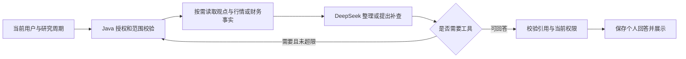

# SPEC-004：单股研究 Agent 设计草案

状态：2026-10-18，AG 要求与 P-001～P-007 已确认。固定梳理、独立个人页面、受控工具和限定财务已接入；4.4 的报告 RAG 在两份受审年报、Windows 单机范围完成维护、混合检索对照及受审摘录的真实六题来源验收。SSE 阶段／最终结果／停止及 4.5 的本机只读 MCP 已验证，实际范围与证据只见 tasks。默认模型和页面预算仍关闭，本机配置单独启用。005F 原财务题真实恢复、007 总体质量、逐字正文和生产仍分别保留；模拟回答或 MCP 协议成功不替代真实模型质量，摘录交付也不等于模型自由概括全部正确。本文说明机制，不替代 [需求](requirements.md) 的确认状态。

## 1. 首个页面闭环

在现有单股研究详情中，按用户选择的研究周期打开研究助手面板。优先在周期标题处提供“研究梳理”入口，通过明确的周期 ID 绑定对象，不把页面筛选／已加载记录自动当成 AI 输入范围。结果结构、原文弹窗与个人对话沿 AG-001～AG-019；财报与数据边界沿 AG-020、AG-021，不另建独立聊天首页。

阅读体验推荐：首次结果沿已确认的报价与梳理结构；追问先给出直接回答，仅补本次必要的依据与缺口，不每次重复整份梳理。报告引用弹窗显示报告名称、报告期、章节和实际引用段落，页码仅在解析器已核实时显示；已入库报告范围在助手内可查看。具体视觉排版在页面阶段走查，不让用户先选择内部字段或检索参数。

初次梳理由 Java 固定完成范围校验、受限周期资料读取及报价获取，再调用模型整理；报价字段由 Java 直接展示。追问由模型在必要时提出查询，由 Java 执行受限工具并回传，然后校验并保存回答。第一次摘要是固定流程，追问中的受控工具选择另验，不能用摘要成功证明 Agent 已完成。

模型 API、费用、主框架与兼容性只采用 [技术规划](../../architecture/technology-stack.md#32-v2-agent-技术规划基线)；新增包按 [项目结构](../../engineering/project-structure.md) 放在 `com.stock.system.agent`，复用现有登录、Result 返回结构和业务 Service。模型网络请求不处于持有业务锁的数据库事务中。

## 2. 当前代码可复用的条件与缺口

| 现有代码 | 可复用能力 | 本阶段需补的能力 |
| --- | --- | --- |
| [周期响应](../../../src/main/java/com/stock/system/stock/vo/ResearchCycleDetailResponseVO.java)、[观点响应](../../../src/main/java/com/stock/system/stock/vo/StockOpinionResponseVO.java) | 周期起止／状态、作者、观点正文、观察条件、日期和撤回标记 | 形成最少字段的模型输入，不直接序列化整个接口响应 |
| [研究生命周期服务](../../../src/main/java/com/stock/system/stock/service/StockResearchLifecycleService.java)、[资料读取服务](../../../src/main/java/com/stock/system/stock/service/StockResearchSourceService.java) | 授权内详情、跨周期时间线；周期完整／超限、单条原文、成员／日期范围及来源重校验已实现 | 时间线仍每批 20 条；资料服务按周期直接查询，不循环翻全股票历史。双连接 RR／新事务校验已验证，公开生成／会话恢复仍待接入 |
| [行情服务](../../../src/main/java/com/stock/system/stock/service/StockMarketPreviewService.java)、[助手适配](../../../src/main/java/com/stock/system/agent/service/ResearchMarketDataService.java) | 授权内最新报价、日 K 和分时；助手已复用报价与有界日 K | 005 已接报价／日 K 原生工具和依据弹窗，模拟行情与真实模型样本通过；真实供应商效果另验。不新建真实行情连接、不改变本地 SDK／生产 CLI 边界 |
| [历史行情响应](../../../src/main/java/com/stock/system/stock/vo/StockCandlestickSeriesVO.java) | 币种、来源、复权口径、模拟标记、获取时间与序列 | 使用 `day` 与 `adjustment=none` 的实际口径；缺交易日或区间不完整时报告实际覆盖。结束周期没有结束价快照，不能凭最新价还原其结束收益 |
| `pom.xml` 的 Longbridge SDK 4.5.0 与现有 SDK／CLI 网关 | 当前依赖已含 `FundamentalContext` 财报方法；已有服务端授权和传输分工 | 当前 Java 网关未封装财务读取。新增受限财务 Service 与两种适配并先实测字段／覆盖；复用授权与会话，不为财报另建 QuoteContext 或改变开发 SDK／生产 CLI 路径 |
| [研究页面](../../../frontend/src/views/workspace/WorkspaceStockResearchView.vue)、[股票 API](../../../frontend/src/api/stock.ts) | 当前空间／股票、周期卡片、授权请求、迟到响应保护 | 增加独立助手组件和原文弹窗；切对象、退出登录及卸载时清理显示状态，沿用请求版本校验，避免旧结果覆盖新对象 |

以上为代码审查事实，不是新 Agent、模型质量、数据库迁移或真实上游验收证据。

## 3. 读取契约与数据一致性

已在股票业务层增加 StockResearchSourceService，后续 Agent 工具通过它的公开方法调用。当前资料接口的用户 ID 从认证对象取得，空间、股票与周期从路径取得后校验归属；会话接入后再由 Java 绑定工具执行范围。模型参数不提供可自行变更的用户、空间、周期、任意代码、SQL 或 URL。

周期读取先确认范围、有效记录数量和文字量。允许范围内完整读取，按观点日期与 ID 稳定排序；包含 INITIAL、UPDATE、REVIEW，排除已撤回正文。统计、读取及截止信息需有一致性边界，模型调用前关闭短读事务；交付前再校验当前访问和所读来源。返回 `scope` 由 Java 生成，包含条件、数据截止、总有效条数、读取条数及覆盖状态，不由模型填写。

当前实现使用只读 REPEATABLE_READ 短事务，让授权、归属、统计与正文读取使用同一数据库快照。`scope.readAt` 是数据库返回的读取时刻，不宣称精确的全局提交截止点；周期身份在外层响应中。范围内返回 COMPLETE，超过 100 条或理由＋观察条件超过 20,000 个 Unicode 字符时返回 LIMIT_EXCEEDED、实际统计和空正文，不截断后生成。成员／日期均只缩小当前授权周期，日期包含起止当天，Scope.filter 保存实际条件；统计、正文和 revalidate 使用同一条件。revalidate 在新的短读事务中重新授权，只统计范围内当前有效总数并重读原快照 ID 对应的有界正文，缺失／正文或作者展示变化拒绝；范围内新增资料标记 newOpinionsAvailable，不自动付费再生成。真实双连接已验证统计后提交新增／撤回时快照一致及新事务校验；证据见任务第 12 节。

超限时先返回“需要缩小范围”，不付费生成假装完整的摘要。按用户选定的日期／成员重读时，标题和结论明确该子范围；成员最新观点只代表本次范围内最新可见记录。时间不明确或成员昵称有歧义时先澄清。生成时出现新增观点可保留带时间的结果；撤回／失去权限导致来源无效时，拒绝交付依赖它的答案，提示重新梳理。

初次快照与价格引用绑定同一币种、时间、来源及模拟状态。行情失败转换为受控不可用信息，不吞掉权限错误。历史价差由 Java 使用同一序列的实际日期和 BigDecimal 计算；分母非正、币种／口径／模拟状态不相容时不计算，不将分红／复权影响或名义变化包装成投资回报。

### 3.1 模型输入与结果校验

研究输入只取需求 P-007 所需字段；显示作者与来源引用映射由 Java 保存。模型不接收 LoginUser、用户认证资料、邀请码、完整业务对象或内部执行权限。用户输入与资料正文作为待分析内容，不允许其中的文字修改工具清单、读取范围或权限。

初次模型结果分为 `overview`、`changes`、`members`、`pendingItems`；条目携带本次返回资料中的引用标识。`quote`、`scope`、作者展示映射与生成时间由 Java 组成，不由模型生成。生成核心已附同一后端报价快照与实际子范围，Prompt 仅发送观点、日期与内部成员别名，报价由 Java 另行展示，当前不向模型提供外部事实。追问使用正文段落与引用的结构，允许简短回答，无需反复输出三块摘要。

固定生成核心位于 ResearchSummaryService／ResearchSummaryPrompt／ResearchSummaryModel／ResearchSummaryValidator。Service 禁止外层数据库事务包裹模型调用；Prompt 使用字段白名单与每次生成的 M1／M2 作者别名，不发送账号身份或完整业务响应。发送前限制序列化消息为 60 KiB，实际完整 HTTP 请求派发前再限制 64 KiB，均不当作 Token 计费量。模型通过 ChatClient 一次同步请求，显式 JSON 对象输出、非思考模式和 2,000 输出 Token；保留用量，拒绝截断、空／不可解析／额外字段结果。Validator 检查正文长度、合法且不重复的引用、同成员前后记录、每成员最新观点及完整成员覆盖，然后重新核对来源。成员条数受本次资料上限约束，changes／pendingItems 各最多 8 项。004 已接 HTTP、预算、幂等与持久化；005 的追问使用 ResearchQuestionService／ResearchQuestionModel，通过 ChatModel 显式控制工具循环，输出 paragraphs＋missingInformation。段落 1～8 条，每段最多 2,000 字符、8 个引用，缺口最多 8 条；合法引用只来自实际工具或有效历史，通用解释可无引用。结构校验不证明语义正确。

来源使用类型区分观点、行情、财务快照和 REPORT 段落；报告携带真实文档版本、章节与段落标识，页面位置只取解析器核实的结果，不由模型编造。财务标识由 Java 绑定本次取得的科目与期间，不能伪造为 opinionId；数值、单位、报告期和比较结果从受控 DTO 取，模型负责解释和组织。查看财务依据时展示生成时实际使用的快照；有经过核验的供应商／披露链接才提供跳转，不由模型生成 URL，不将供应商结构化数据假称为已读发行人原始 PDF。查看及恢复仍校验当前对象权限。

Java 校验字段类型／长度、合法引用、对象归属与当前访问；核对成员比较采用的记录是否符合范围内最新规则。小实验的 changes 只允许同一成员前后变化，至少引用该作者的两条不同记录，单条现状不能冒充变化。引用 ID 存在不代表语义支持正确，判断变化、理由和事实边界仍需固定问题集与人工核对。空结果、截断、错误对象、未知引用及不可解析结果不展示为完成答案。前端优先按结构渲染文本，不执行模型返回的 HTML 或脚本。

## 4. 首批工具适配

005 的三个工具之上已接入 `read_financial_facts`，财务采用下方限定的官方年度报告库；008 首段另接 search_report_passages，契约与维护边界见 4.4。财务程序及受控网页证据见 tasks 第 17 节，真实模型财务质量沿 005F；完整 V2 还须完成 [受控文档 RAG](../../product/requirements-v2.md#33-必做阶段受控文档-rag) 的剩余维护与质量验收，不把工具追问通过当作整个 V2 完成。初次梳理不默认拉取全部报表，财务／报告工具按具体追问触发；通用概念、成员观点、财务事实与报告陈述分清。

| 拟用工具 | 模型可选参数 | Java 返回与校验 |
| --- | --- | --- |
| `read_cycle_opinions` | 可选作者标识、开始／结束日期 | 固定当前研究对象；作者须来自可读取范围，日期须合法，完整／超限状态和来源标识由读取 Service 返回；不返回撤回正文 |
| `read_latest_quote` | 无研究对象参数 | 查询该股票最新可用报价，返回后端快照及时间／来源；当前价格问题须用本次获取的快照，不能把历史聊天中的价格标成现在 |
| `read_daily_prices` | 开始／结束日期 | 仅同一股票日 K，范围与条数受限；查询上游后按实际日期过滤，返回实际覆盖、复权口径、来源与 Java 计算的名义变化。上游最少 20 条与内部有界多取需适配，不能直接传入小于现有 Service 下限的 count |
| `read_financial_facts` | 白名单财务指标、报告期类型、可选明确财政年度 | 股票由 Java 绑定；按已经验证的市场／科目映射读取有限期间，返回真实数字、科目口径、币种／单位、报告期、来源／获取时间、覆盖与缺失状态。同口径计算由 Java 完成；年度／季度／累计不能混比，未知字段、期间或越界查询拒绝 |

已有资料足够时可直接回答，不为展示“Agent”强制查询。所有模型请求中的工具名和参数都经白名单校验；同一请求可能提出多工具，额度按实际调用逐个计数。拒绝的调用也有对应错误结果，保持 tool_call_id 配对，不把失败描述成查询成功。限制达到后终止补查，说明未完成范围。

普通工具参数校验与最终回答 DTO 校验分开。历史独立实验采用原生工具选择阶段和无工具的 JSON 作答阶段：缺正文时开放 auto 工具选择，成功读取后关闭工具并要求最终结构；已有完整资料直接组织答案。两阶段计入同一请求额度，不依赖 Beta strict 模式。正式多工具采用下段显式循环，补查与停止条件已沿 005 另验；不由独立实验推断接口与业务效果。具体接口依据见 [模型接入安排](../../architecture/technology-stack.md#35-首轮模型与费用安排)。

正式追问由 Java 显式执行循环，不让框架隐藏补查。ChatModel 返回 AssistantMessage 的原生工具请求，ResearchQuestionService 校验工具名、严格参数和唯一 call ID，再调用当前 Java 绑定对象的 Service；每个请求都有同 ID 的 ToolResponseMessage，包括参数错误和次数用尽的错误。模型不能传用户／空间／股票／周期 ID 或任意 SQL／URL；观点作者仅接受本次 M 别名，日期只能缩小选定范围，报价只接受空对象，日 K 日期最多 31 自然日。接财务后最多三次工具尝试、四次模型请求，无效尝试也计额度；第四次模型请求或工具额度用尽时关闭工具并要求 JSON，仍请求工具则终止，不自动重试。每次模型调用前、工具执行及保存时核对当前权限、来源、运行与上下文版本。

观点原文映射由 Java 保存，行情生成 QUOTE／DAILY_PRICES，财务生成 FINANCIAL 类型引用及实际快照。点击依据先 GET 当前 run 重新授权，再显示生成时快照，不付费重查、不把旧快照改成当前值。财务还与当前报告库核对报告哈希、科目、金额、单位、比较及页码；不只凭相同 PDF 哈希接受被改过的数字。版本移除或口径变更导致不匹配时整条回答失效，历史与当前查询均遵守。累计不同观点依赖最多 100 条，最多保留主快照加三次实际观点工具快照；超限返回明确缺口。

### 4.1 股票数据覆盖与接入状态

2026-10-09 核查数据源，2026-10-14 同步正式三工具状态。表中“平台有接口”只表示官方列出能力，不表示当前账号、每只股票、每个市场和每个历史期间已验收。此表维护数据边界，其他文档只引用，不将未列字段默认为可查或绝对不可查。

| 数据类别与代表问题 | 来源能力与限制 | 当前 Java 项目 | V2 阶段安排 |
| --- | --- | --- | --- |
| 本空间研究：谁何时改观点、共识／分歧 | 自有 MySQL；只读当前权限内且未撤回的观点 | 周期完整／超限读取、日期／成员子范围、原文与交付前重校验已接入 | 正式受限工具已接入；真实质量按具体样本核对 |
| 股票身份：代码、名称、市场、币种、交易状态 | 已有可信目录及交易状态核实；查到代码不等于能取得全部数据 | 已接入；无价格状态与核实时间可单独返回 | 作为所有工具的对象依据 |
| 最新价格：当前最新可用价、何时报价 | [行情接口](https://open.longbridge.com/zh-CN/docs/quote/overview) 可查，实时性取决于 OpenAPI 权限与数据时间 | 已接入 lastDone、时间、来源等；不能由 SDK 更丰富响应推断项目已暴露全部字段 | 必做，首次结果默认展示 |
| 历史行情：日开高低收、成交量／成交额、短期名义变化 | 同上支持 K 线／历史，实际跨度、复权与标的额度有边界 | 已有 OHLC、volume、turnover 和历史读取 | 必做有界日 K；不承诺任意长历史或完整投资回报 |
| 分时及技术指标：今天分时、均线／MACD | 同上有分时；技术指标需明确定义和行情序列计算 | 分时已接 V1；Agent 分时工具、MA／MACD 尚未接入 | 分时／技术指标不自动列入首版工具；可后续复用／计算 |
| 核心财报：营收、净利润、资产／负债、经营现金流及同比 | [财报 API](https://open.longbridge.com/zh-CN/docs/fundamental/fundamental/financial-report) 支持三表；独立 SDK 已取得一个 A 股、一个港股样本的年度／半年度核心数字，样本不证明全市场覆盖 | 财务业务 Service／工具尚未实现；供应商展示币种与原报口径、季度覆盖和生产 CLI 路由尚未全部核实，证据见 tasks | 新增必做；按验证后的科目／期间接入，不能把供应商展示数直接当原报数 |
| 估值：PE／PB／PS、市值、估值历史 | [估值接口](https://open.longbridge.com/zh-CN/docs/cli/fundamentals/valuation) 有相应能力，指标口径／时点和覆盖仍需核对 | 尚未接入，不能由最新价单独算出全部估值 | 后续候选；核心财报不自动等于估值工具 |
| 公司经营：行业／主营、业务收入构成、分红 | [基本面概览](https://open.longbridge.com/docs/fundamental/overview)、[业务分部](https://open.longbridge.com/zh-CN/docs/cli/fundamentals/business-segments) 列出能力，细分科目依标的而异 | 尚未接入 | 后续候选，不承诺每家公司都有完整细分数据 |
| 新闻：最近报道、标题／发布时间／正文 | [资讯接口](https://open.longbridge.com/zh-CN/docs/cli/content/news) 有按股票读取与文章详情；不代表全网完整覆盖 | 尚未接入 | 后续候选；不能以模型知识冒充刚查到的新闻 |
| 公告／财报原文：公告说了什么、管理层为何解释增长 | [文件接口](https://open.longbridge.com/zh-CN/docs/cli/content/filing) 明列美股 SEC 与港股披露；该页不能证明 A 股公告覆盖；正文、附件可读性另验 | 已接茅台／腾讯 2025 中文年报的受审文字章节；任意公告、完整附注仍未接入 | 来源与范围见 4.4，采用系统维护的官方公开报告，不以本接口覆盖全市场为前置；结构化财务数字与有限文字段落分别取证，不能假称已读整份报告 |
| 盘口／逐笔／资金流、股东／机构持仓 | [行情概览](https://open.longbridge.com/zh-CN/docs/quote/overview)、[基本面概览](https://open.longbridge.com/docs/fundamental/overview) 有相关接口；部分受付费级别、市场及披露频率限制 | 尚未接入 | 后续候选；席位／资金统计不能当成交易者真实意图 |
| 评级／目标价／盈利预测、指数成分／宏观日历 | [基本面概览](https://open.longbridge.com/docs/fundamental/overview) 与 [官方更新](https://open.longbridge.com/docs/changelog) 列出能力 | 尚未接入 | 后续候选；预测须标机构、日期和预测性质，不能当作未来实际结果 |
| 用户证券账户持仓／盈亏／订单 | [账户接口](https://open.longbridge.com/docs/cli/account/portfolio) 需账户权限；网站共享关注不等于券商持仓 | 未接券商账户，不取得其他成员资产 | 非本阶段范围；不自动交易 |
| 未公开业绩、内幕、未来确定股价／真实主力意图 | 未公开或未来事实没有可供可靠查询的已知结果；报道、预测与推断不能变成确定事实 | 无此事实查询能力 | 明确不能保证；允许基于已读材料提出带条件的推断 |

同一数据类别的失败须区分：项目未接入、来源未覆盖该市场／标的／期间、科目缺失、账号无权限、超时／接口故障、事实尚未知。已取得部分可以回答并列缺口；不可用不能变成零值。用户自由提问不等于自由访问任何数据源，实际可用工具与覆盖由 Java 决定。

行情时效的官方边界：OpenAPI 权限与手机客户端／PC／网页端独立；基础权限列出美／A 股报价及港股 BMP 约 15 分钟延迟，港股实时及 LV2 另有权限要求。本轮没有查看用户实际订阅，不能据此断言其港股报价具体延迟。项目以授权及真实时间说明最新可用数据，不将“实时信息”作为所有类别的统一承诺。财报按披露更新，股东数据按披露期更新，均不同于盘口时效。

### 4.2 财报查询的边界与来源

首批科目以营收、明确口径的净利润、总资产、总负债、经营活动现金流为主；EPS／利润率只在对应映射和单位已验证时加入。输入初值最多 8 项、一个目标报告期加一个同口径可比期。返回可用报告期及缺失项；用户指定未覆盖期间时说明，不能悄悄用别的期间。最新问题查询数据源最新可用期并明确这种范围，未核实披露日／源端更新完整性时不称最新已发布完整报告。完整三表明细、所有历史、附注、扫描 PDF 和任意用户上传不作首批前置。

财务 DTO 除数字还带源字段及显示名称、利润口径、期间类型／结束日、币种、数值单位、来源标识、获取时间和比较依据；来源有发布日期才记录，没有则明确未知。`fp_end` 是报告期结束，不能映射为发布日期；仅有 currency 也不能猜测金额是元、千元或百万元。科目 mapping 依据真实响应和官方定义建立白名单，归母净利润不自动映射为任意 net income；非通用行业科目或含义不清时先返回不支持。

初次实测识别的候选字段为 `OperatingRevenue`、`NetProfit`、`TotalAssets`、`TotalLiability`、`NetOperateCashFlow`，对应源端收入、利润、资产、负债及经营现金流展示；正式映射须继续核实利润定义、单位与币种转换，不能由字段名推断所有公司同口径。DTO 区分发行人原报与供应商展示口径，记录已知转换依据；展示币种不同而换算方法未知时，不反推原币金额或声称核对了原报同比。只有确认可比性后才计算对应口径变化。

比较使用同公司、同币种／单位、同利润口径和同期间类型；同比／绝对变化由 Java BigDecimal 计算。基期为零或负数等不适合普通增长率的情形说明绝对变化及原因，不硬给常规百分比。可比期缺失不算同比，不拿全年数与单季或累计数比较，不推断增长必由某业务原因造成。读取结果不足以证明成员全部结论时限定为已核对的这一项。

追问结果先直接回答所问内容；涉及数字比较时只展示必要指标、目标期、可比期及同口径变化，附报告期、币种／单位、来源与获取时间。点击财务引用沿第 3.1 节查看实际使用的快照；未取得原报全文时仍以数据依据命名，不冒充原文。问题未指定期间时依据已验证的期间覆盖说明本次选取；“最新可用”不能悄悄等同于 Annual 的默认响应。

财务读取独立于报价故障，按股票业务 Service 组织，可复用短缓存；对“现在最新”保留获取时间与缓存来源，不悄悄用聊天旧数字。工具入口继续确认当前空间及股票权限。早期真实数据预检无需模型、数据库写入或额外行情连接，运行条件按测试规则核对；预检不通过先核对身份／权限／期间并评估官方公开披露或另一合法来源。新的付费服务、账号授权或全文解析另定，不把假数据替代真实数据来宣布财报完成，也不等全文路径验证才展示研究＋报价里程碑。

2026-10-14 已准备候选基础层：[StockFinancialService](../../../src/main/java/com/stock/system/stock/service/StockFinancialService.java) 在读取前后核对空间访问与股票身份，外部请求不占数据库事务，也不调用报价 Service。[解析器](../../../src/main/java/com/stock/system/stock/financial/LongbridgeFinancialParser.java) 只保留五项白名单科目、一个目标期和同标签的上年可比期，可用期间最多返回 12 个；源 JSON 输入最多 2MB，各组／科目／历史值均有数量界限。首次接受已实测的 FY、H1 和日历季度 Q1～Q4 标签；与结束日不符、未来结束日和未知期间不参与选期。显式期间缺失返回 PERIOD_UNAVAILABLE，不逐科目退回旧期；空值／占位符不转为零，重复科目期间或异常响应返回来源错误。

Longbridge 真实端点仍缺少足够的单位、原报币种／转换和利润定义契约，其 DTO 保持 PARTIAL：单位及利润口径标 UNKNOWN，币种基准标 PROVIDER_DISPLAY_UNVERIFIED，发布日期为空；该适配不启用同比，未经核实的金额不会进入财务工具的模型输入或引用。开发 SDK／生产 CLI 的既有传输边界保留，不由另一路原报核实把供应商全市场口径标成已验证。

正式财务工具优先使用 [官方年度报告库](../../../src/main/java/com/stock/system/stock/financial/OfficialFinancialReportCatalog.java)：当前仅贵州茅台、腾讯的 2025 年年报及同份报告 2024 年比较列，五科目、原报人民币元／百万元、归母／股东应占利润。腾讯总负债由同一报表总资产减总权益得到，保留公式名称及两页定位；不冒充原报直接列出的独立科目。股票和原报位置由 Java／系统维护清单绑定，模型只传 series、period、metrics（最多五项、不重复）；不接受 URL、文件或对象 ID。明确缺失期间不切到别的年度，半年度、季度和其他股票保留不可用／未核实反馈。最新仅指该报告库当前可用范围，不能忽略已存在但尚未导入的其他披露。

[导入脚本](../../../scripts/import-official-financial-reports.py) 只解析 [受审清单](../../../scripts/report-sources/official-financial-reports.json) 中哈希固定的文本 PDF，核对页数、年度列、单位、唯一行及数字数量后生成 [金额目录](../../../src/main/resources/financial/official-annual-reports.json)。解析失败不猜数，不覆盖旧目录；不构成通用 PDF、OCR 或 RAG。后端启动时校验有界目录，读取前后检查访问；[Java 比较](../../../src/main/java/com/stock/system/stock/financial/FinancialFacts.java) 先判可比性，再用 BigDecimal 算变化。金额／变化以十进制字符串输出，避免浏览器丢失精度；报告期结束日仍非公告日，未核实发布日期保持为空。引用快照存入既有 agent_message 的 result_json，包含来源标题、URL、SHA-256 和按 PDF 文件计数的页码；无需另建表。网页重用既有依据弹窗，窄屏表格内横向滚动，来源链接只取 Java 核实的地址。

正文仍需独立核对：v7 禁止模型自行换算金额单位／币种或改动有效数字。新回答中实际带财务依据引用的段落，经 [数值保护](../../../src/main/java/com/stock/system/agent/service/ResearchFinancialAnswerNumbers.java) 检查本段引用材料中的数字、常见金额单位／币种组合与百分比，不符合则按 INVALID_RESULT 失败、不保存正文，已知模型用量仍结算。共同引用的报告、报价及成员原文保留其已有数字；概念段落不套用财务单位，历史已保存正文不追溯改写。该保护不证明科目／期间对应和增减语义正确，完整范围和真实失败见 [BUG-012](../../engineering/bugs/BUG-012-financial-answer-unit-conversion.md)，实际复测另验。

v8 每轮模型请求都指定 response_format=json_object：可用工具不代表本轮一定返回 tool_calls，直接回答也须保留 JSON 契约。原生工具消息仍由 Java 有界循环执行；结构、引用和金额校验保留，JSON 模式不等于语义正确。解析拒绝仅按固定大小／JSON／契约／财务阶段进入既有安全诊断，不保存原始正文或异常消息，不自动补发收费纠错请求。报告覆盖范围也须先查工具再判断，模型工具选择是否正确仍在固定题集单独验收；官方约束见 [JSON Output](https://api-docs.deepseek.com/guides/json_mode/)。

v9 在带财务引用的段落中，要求只来自 Java 百分比的数值带 `%`；相同数字若亦来自其他已引用资料／元数据则保留歧义边界，不由字面相同强行推断语义。纯报告查询全部得到 NO_REPORT／NO_MATCH、没有已有或新取得的引用材料且工具无错误时，Java 将校验通过的最终回复收束为实际股票／年度的覆盖说明，不让无证据的公司常识混入。失败／不可用、其他工具组合、已有历史材料或取得候选的回答不走这一替换路径；原生模型用量照实记录，身份校验、保存和后置权限检查不变。

v10 对实际带 REPORT 引用的事实段落采用受审原文摘录交付：[ResearchReportAnswerSupport](../../../src/main/java/com/stock/system/agent/service/ResearchReportAnswerSupport.java) 从本次已授权材料取完整原段及页码，按引用去重，不采用模型改写的限定词或对象范围。报告与成员／财务依据须分段，混引拒绝而非丢弃其他依据；摘录展开后仍限八段、每段两千码点。成员／财务解释继续经原规则校验，纯空检索沿上段的覆盖说明。取舍是报告事实优先忠实引用，暂不承诺模型能可靠地自由概括；旧已保存正文不追溯改写。实际坏例和证据边界见 [BUG-013](../../engineering/bugs/BUG-013-report-scope-generalization.md)。

### 4.3 接口与本地依赖核查

2026-10-09 已离线检查 `openapi-sdk-4.5.0.jar`：有 `com.longbridge.fundamental.FundamentalContext`，实际签名为 `getFinancialReport(String, FinancialReportOptions)`。官方页面中的无 options Java 简例与当前依赖签名不同，实施以已用依赖的类型和编译结果为准，无需仅为方法存在而升级 SDK。

本机 CLI 0.28.7 的 `financial-report --help`／`financial-statement --help` 和 schema 已检查；2026-10-14 又实读财务指标端点，生产容器 CLI 0.28.5 的版本、help 与四组只读样本也已核对，覆盖只见 [任务第 16 节](tasks.md#16-财务读取基础层与生产源核对2026-10-14)。financial-report 的 kind／latest 有账号地区路由差异；不能把账号地区和证券所属市场混为一谈。financial-statement help 的 kind 默认是 IS，而网页示例称不传等于 ALL，实施必须显式传所需类型并核对结果；不能由 help 存在推断标的确有数据。

开发侧候选适配使用 SDK 管理的既有 OAuth，惰性创建独立的 HTTP 财务会话并按生命周期关闭；不先创建 QuoteContext，也不等待报价成功。生产侧在既有 CLI 管理器中增加财务读取方法，复用同一 serve。按 [serve 文档](https://open.longbridge.com/zh-CN/docs/cli/serve)，只发送 `api.get`，path 固定为 `/v1/quote/financial-reports`，query 只有 Java 绑定的 symbol、ALL 和受限 report；任意路径／URL／写接口不暴露给调用者。两侧都有排队／超时和请求间隔，SDK 超时取消在途 future 并关闭该财务会话，不自动重试。生产真实证据来自容器内单次 HTTP 命令，候选 serve 方法的协议与复用通过假进程检查；尚未部署新适配，也未向现有生产 serve 注入请求，不能混为线上业务验收。

独立入口为 [Java 探测程序](../../../scripts/LongbridgeFinancialProbe.java) 与 [PowerShell 启动脚本](../../../scripts/probe-longbridge-financial.ps1)，不启动 Spring／数据库／模型；默认 Offline，Live 固定读取两个标的的 Annual／SemiAnnual，Verify 读取 Annual／QuarterlyFull，Diagnostic 只读一个固定样本。科目摘要使用相同的五字段白名单，最多五行历史用于观察季度上年同季；百分比和展示跳转对象排除。脚本使用 JAVA_HOME 中的真实 JDK 和已有本地依赖；仅读取本地 public client 配置，授权缓存由 SDK 管理，交互授权需求会终止，不自动打开浏览器。真实请求之间间隔 1.5 秒为本次探测初值，遇限流停止，不自动重试；不将此初值当供应商保证。

真实响应的适配注意点：`FinancialReports.list` 是 JSON 字符串；样本中的 `periods` 是 `af`／`qf`／`cumul` 等展示选项，而实际财报期在科目 `values` 的 period／year／fp_end 中；`entry` 可能是嵌套的展示跳转对象，应排除于财务输入。实测同比数字按百分数展示，官方简例存在不同尺度，正式计算优先依据经核准的可比值，不能未经验证直接格式化 yoy。程序仅输出受限的科目元数据／数值摘要，单位和最新披露状态不自动标为已验证；具体实测与公告对照只见 tasks。

### 4.4 报告资料库与 RAG 接入

产品范围沿 [系统维护的公开报告资料库](../../product/requirements-v2.md#33-必做阶段受控文档-rag)，不增加普通用户上传或个人建库流程。001R 之后，008 已完成正式 Java 工具、同一助手页面和本机受控维护，限定为受审的两份 2025 年报文字；混合检索与一次本地重排对照、受审摘录交付的真实六题关键来源验收已通过。自由概括、任意问题和生产运行不由该限定证据承诺。

2026-10-17 的 001R 已在两份中文报告的受审文字范围验证条件，证据见 [任务第 22 节](tasks.md#22-中文报告解析与本地检索预检2026-10-17)。预检使用 [文字来源清单](../../../scripts/rag-preflight/sources.json) 中的版本和段落边界，茅台复用财务清单的来源身份；腾讯中文原版独立核对官网链接及哈希，不替换现有英文原报财务目录。PyMuPDF 解析后只去除空白，按同一 PDF 页内的 Unicode 码点保留起止位置，段落不跨页；定位属于该解析与归一化版本，不能直接当作 PDF 字节或 Java UTF-16 下标。原报哈希、段落哨兵或定位变化即拒绝。

预检的 Python 本地模式保留为独立证据。[导出脚本](../../../scripts/rag-preflight/export_catalog.py) 先核对已审文字和位置，既可更新随包目录，也可导出单份报告供系统维护。[ReportCatalog](../../../src/main/java/com/stock/system/agent/report/ReportCatalog.java) 读取 [ReportLibraryStore](../../../src/main/java/com/stock/system/agent/report/ReportLibraryStore.java) 的本地发布记录；正文、码点位置、原报版本和官方链接逐项校验，不从向量 payload 恢复来源。仅首次没有发布记录时从随包目录初始化；之后更新、移除与重启均以发布记录为准，不能因内置材料仍存在而自动恢复已移除报告。

[LocalReportEmbedding](../../../src/main/java/com/stock/system/agent/report/LocalReportEmbedding.java) 使用同一固定 BGE 权重，沿 Spring AI EmbeddingModel 契约在 Java 中取 CLS 向量并归一化；查询指令与正文编码分开，拒绝截断、错误维度与非有限值。Qdrant 采用官方固定 Windows 程序，由 [ReportVectorStore](../../../src/main/java/com/stock/system/agent/report/ReportVectorStore.java) 经 Spring AI VectorStore 契约及回环 REST 调用。仅本机开关启用后按需启动，不建立 Python 业务服务；正文不为向量化外发。集合名称由正文目录与 Java 编码版本共同派生，索引元数据限定股票、年度、模型与可用状态，返回后再与权威段落匹配；最多三个候选，当前 0.45 沿预检冻结，不作为通用可信度。路径保持短名以兼容 Windows 段文件。

当前只有十四段，本机维护采用同步命令和有界原子文件记录，不新增常驻 Python、后台任务表或 MQ。导入先登记 PROCESSING，再在锁外校验并建立候选索引，成功后发布 AVAILABLE；失败记 FAILED，有上一可用版时继续使用该版，没有则不能查询。首次随包初始化仍按需建立索引；在线更新后，业务查询按完整当前目录切换或重建自己的索引。维护用独立回环端口与目录，不接管日常服务；操作步骤只见 [工程笔记第 12 节](../../engineering/agent-experiment.md#12-报告检索如何进入正式助手)。大量报告、后台自动推进或跨实例并发出现时，再按 [异步方案评估](../../product/backlog.md#9-报告处理的异步方案与-mq) 比较同步、持久化任务表和 MQ。

工具 search_report_passages 只接受 query（最多 240 码点）和可选 year；可信股票从授权的当前周期绑定，观点日期不套用为报告日期。GET 当前 agent/reports 返回该股票可用报告／章节、检索开关和处理状态；页面每次展开资料区重新读取。无报告、无相关候选和故障分开返回。REPORT 依据保存实际段落和版本，引用 ID 由 Java 产生，最终仅保存本次真正引用的非观点依据。刷新和点击先校验当前 run 权限，再核对已发布的对应历史版本；正常更新保留旧依据，移除或发布记录损坏则不从消息 JSON 恢复原文。页面说明正在更新、更新失败时使用旧版或已移除，引用仍可打开原文、章节、PDF 页码与官方原报。

本地数据目录持有独占文件锁，不接管其他目录或已有监听端口。记录子进程 PID、创建时刻、可执行文件、父进程及其创建时刻、数据目录和端口；正常退出关闭自建进程。父进程被强制终止后，仅在下一次取得目录锁、确认旧父进程已退出且子进程身份全部匹配时回收重建。Windows JDK17 不提供进程参数，不能把读取参数作为该平台唯一校验条件。当前只验收本机 Windows，生产容器、Linux 存储和上线配置另验。

维护命令每次只接受一份已审报告 JSON，身份由股票＋年度＋语言组成，原报哈希与段落目录哈希分别保存。相同可用版本重复导入不重建；更新产生新版本，不覆盖旧回答依据。PROCESSING 时保存递增代次和任务令牌，完成／失败回写必须匹配；remove 增加代次并标 REMOVED，阻止迟到成功或失败改写它。中断保持 PROCESSING，retry 显式接替；REMOVED 只能显式 restore，普通 import 不恢复。扫描件、复杂表格或提取失败的章节仍不支持，不由模型补齐。

本机 `.local/report-rag/library/library.json` 保存公开正文、状态与版本关系，独立锁文件保护短暂写入，临时文件 force 后原子替换，损坏时拒绝使用而不回退随包材料。边界为 2 MiB、50 份报告、每份 20 个发布版本，超限拒绝新发布而保留原版；这不是 MySQL 报告状态表或可自动恢复执行的任务队列。现有私人聊天、运行及预算仍在 MySQL。选择文件是因为当前单机小语料、无并行后台导入；多实例或生产集中维护再评估将元信息／状态迁入 MySQL。向量库仍是可重建索引，Java 查询后再核对当前可用正文，历史查验则核对对应已发布版本；公开报告可被同股票不同周期复用。

文档问题按需检索，普通报价不强制附带文档查询。[ReportRetriever](../../../src/main/java/com/stock/system/agent/report/ReportRetriever.java) 在同一股票／可选年度的发布快照内组合两路候选：向量沿 0.45 门槛取最多 12 段；关键词对受审章节标题与正文做 CJK 双字／英文词 BM25，去掉通用提问词，至少两个命中项且 IDF 加权覆盖不低于 0.20，单个明确英文产品名例外。每路最多 12 段，按来源 ID 去重，等权 RRF（k=60）融合，最终仍只向模型提供三段；RRF 分数不与余弦分数混加，也不当作答案可信度。排序实现与版本只在 [ReportRetrieval](../../../src/main/java/com/stock/system/agent/report/ReportRetrieval.java) 维护，机制参考 [Qdrant 排名融合](https://qdrant.tech/documentation/search/hybrid-queries/) 与 [BM25 参数说明](https://www.elastic.co/docs/reference/elasticsearch/index-settings/similarity)。不新增向量库、模型下载或收费服务，也不做繁简转换；向量故障仍返回 UNAVAILABLE，不静默退成另一种检索。

默认 retrieval-mode=HYBRID、rerank=false。保留 VECTOR／KEYWORD 对照模式，rerank=true 时按同一批候选的 IDF 查询词覆盖率重新排序，相同覆盖率保留原排序；这是本地词法重排，不是 Cross Encoder 或付费模型重排。选择依据为冻结校准题的首位／前三命中和无答案拒绝，留出题不用于继续调参；实测重排出现倒退，因此没有默认开启。逐题排名、版本、题集哈希、前后坏例子及单次耗时见 [第 27 节](tasks.md#27-混合检索重排对照与报告评估入口2026-10-18)，小语料成绩不外推通用准确率。

组合问题允许同时引用观点、财务快照和报告片段，须标清来源与时间；报告陈述不自动成为已核实经营因果。空检索、低相关或段落不能支持答案时说明缺口，不由模型记忆伪造报告依据。

移除后当前检索与历史依据立即受业务状态阻止，即使磁盘仍有旧向量，也不得继续返回；正常更新保留已发布历史版本，旧回答不静默换成新依据。权限失效或资料撤回后的依赖按第 6.1 节处理。当前尚未自动回收历史索引与版本，也没有后台自动重试；物理回收、生产共享存储与真实模型的答案依据质量继续留在 008。

### 4.5 MCP 学习实践边界

沿 [至少一个 MCP Server 的学习目标](../../product/requirements-v2.md#34-必做学习实践至少一个-mcp-server) 执行 AG-CODE-009。当前实现为独立本机 stdio 入口 `ResearchMcpCommand`，使用官方 Java SDK 2.1.0（Jackson 3 适配），不启动第二套 Spring／数据库／行情／回答模型。它把现有周期资料 REST API 适配为唯一只读工具 `read_current_cycle_opinions`；真正执行仍经原 JWT 过滤器、Controller、StockResearchSourceService 和数据库，不复制权限 SQL。普通站内 Agent 仍直接调用 Service，没有为了协议再绕一遍子进程。

取舍：现有需求是一项本机只读工具与真实客户端实践，stdio 由客户端拥有进程，账号和周期可随启动明确绑定，也不需要新增远程 MCP OAuth 授权服务器。Streamable HTTP 留给确有跨主机场景时评估；普通 REST JSON 接口并不因此成为 MCP。工具发现、能力协商和调用消息由官方 SDK 实现，当前客户端／服务端实际协议版本以 tasks 的运行证据为准，不把最新规范版本和已协商版本混为一谈。依据 [MCP stdio 规范](https://modelcontextprotocol.io/specification/2025-11-25/basic/transports)和 [Java SDK](https://java.sdk.modelcontextprotocol.io/latest/server/)，不把连接 ID 当作业务身份。

一个进程只绑定环境中的账号访问 Token、空间／股票／周期 ID 和 `http://127.0.0.1:端口` 源地址；不允许用户信息、路径、查询串、其他主机或重定向目标。Token 只放源端 Authorization 头，不进入工具 schema、参数、结果、启动参数或日志。每次工具调用都请求当前资料，因此已初始化连接不绕过改密／凭据失效、成员退出、对象归属或观点撤回。工具参数只有可选 ISO 日期区间，额外字段及非法日期在联网前拒绝。客户端若需要另一账号／周期，应以另一配置启动进程，不能靠模型传 callerUserId 或 MCP 会话 ID 切换权限。

服务每进程最多两次并发源查询，HTTP 全响应期限默认 10 秒、允许配置 250～10000 毫秒，流式接收最多 128 KiB，输出白名单资料最多 64 KiB；超限返回明确失败，不截断观点。成员只映射为本次 M1 等标识和显示昵称，不返 authorUserId、账号信息或原始异常。业务权限错误映射固定码，其他源端故障／超时／无效响应使用固定工具错误，应用层不自动重试。响应保留 `content` 文本及 `structuredContent`，错误使用 isError，不伪造空成功。源端已有单次 100 条／20000 字符限制继续生效，不扩大成全局业务限制。

stdout 只输出 SDK 协议帧，日志不写 stdout；启动失败只在 stderr 给固定诊断。Java 17 Windows 客户端存在按本机默认代码页读取 stdio 的路径，中文真实调用曾复现乱码并破坏 JSON；服务端协议 JSON 使用 Unicode 转义（合法 UTF-8 的 ASCII 子集），解码后的成员中文正文保持原样，独立 JVM 同时显式选 UTF-8。stdin EOF 后关闭 MCP，客户端关闭后核对本轮子进程退出。使用步骤、参数与退出方式只见 [实验说明第 13 节](../../engineering/agent-experiment.md#13-本机只读-mcp-服务)。WorkBuddy／Codex 产品接入、远程 HTTP MCP、OAuth、外部金融许可及个人掌握另验，不由本机协议验证宣称已完成。

## 5. 调用、费用和失败限制

以下为实验及首个闭环的配置初值，待样本实测后锁定；放宽输入、调用或并发前重新评估费用与响应时间，不由模型决定。

| 项目 | 拟用初值与行为 |
| --- | --- |
| 周期资料 | 最多 100 条有效观点、理由及观察条件合计最多 20,000 个 Unicode 字符；同时受整个请求大小约束，不能承诺任意 100 条必然装得下 |
| 历史行情 | 区间不超过 31 个自然日，一次最多向上游获取 60 条日 K 后筛选；返回实际交易日，不能将非交易日补成假价格 |
| 财务资料 | 最多 8 项已验证指标、目标期和一个同口径可比期；若上游返回更多历史，仅将本次需要的有界结果送给模型，上游请求量和时限仍需限制 |
| 会话上下文 | 从最近 6 轮有效完整问答起取，整轮缩减并说明未携带全部聊天历史；不自动调用模型压缩。指代缺必要上下文时澄清，旧资料须重新读取 |
| 请求输入与输出 | 序列化请求体初始限制 64 KiB UTF-8 字节，模型 max_tokens 初始 2,000；字节上限用于程序保护，不当作准确 Token 计费量，允许基于质量结果调整输出上限 |
| 执行次数 | 小实验及最早页面每个提问最多 3 次模型请求、2 次模型提出的工具执行；接财报后的先行闭环初值最多 4 次模型请求、3 次工具执行，以允许研究＋报价＋财报组合，仍须实测并受同一预算约束。RAG 组合问题沿同一有界原则验证，不自动放宽；超限时缩小问题或说明未完成范围。初次固定的资料与报价读取另记，并同样受数据、总时限与权限限制；预算和计数必须在调用前检查 |
| 时限 | 每轮总时限初始 60 秒，网络请求限时不得超过剩余时间；记录超时阶段，迟到结果不得完成或覆盖新对象 |
| 并发与重试 | 小实验单请求串行；首个页面同一用户最多一轮生成，总并发初值 2。不自动付费重跑，不对相同 requestId 重复执行；限流反馈保留输入 |
| 实验预算 | 从技术栈的首轮上限读取；先预留本次请求可能的最高费用，再按真实用量结算。估算不准时不能假称硬上限，需使用模型声明的最大输入／受控输出与较高单价作保守预留；超时等用量不明时继续占用预留，直到核对，不立即释放给下一次调用。RAG 的收费向量化／重排与回答分别计量；新增服务账号或预算外费用先落实授权，不能把现有 DeepSeek Key 推断为其他服务也可用 |

这些数值是项目初值，不是招聘门槛或已测性能。输入过长时先缩小研究资料或减少历史上下文；不默默截断某条观点正文。结构正确而内容错误仍算质量问题。无权限不自动重试，额度不足不切换付费模型，报价暂不可用不阻塞已有观点整理；业务／模型错误对用户使用可理解的原因，不显示密钥、内部提示词或原始供应商错误堆栈。

004 当前门控：固定首次梳理每轮至多一次模型调用，强制 `deepseek-flash`／非思考／2,000 输出，实际完整 HTTP 请求在派发前核对 64 KiB。整体执行上下文以 60 秒计时，连接／读取 timeout 不超过当时剩余时间，交付前再检查；数据库保存用短事务，不跨网络持锁。不自动付费重试。超过 120 秒仍为 RUNNING 的遗留运行恢复为 INTERRUPTED，不重发且保留费用占用。

费用按 [2026-10-13 官方价](https://api-docs.deepseek.com/zh-cn/quick_start/pricing/) 的 Flash 高峰输入未命中 2 元／百万、输出 8 元／百万计算上界；官方当前上下文为 1M，本项目仍用更保守的 2M 输入＋2,000 输出预留 4.016 元。它不把字符数当 Token，也不宣称等于实际账单；有真实用量时按上述上界结算，JSON 无效仍计费，用量缺失／超时保留预留。派发前失败释放本轮预留，清空不释放已发生或未知费用。别名或定价变化须重新核对后才能启用。

接财务后的追问整轮预留 8.452608 元，按最多四次请求、每次官方 1M（保守按 1,048,576）输入 Token 加 2,000 输出及高峰输入 2／输出 8 元每百万计算；2026-10-14 已重新核对 [官方价格](https://api-docs.deepseek.com/zh-cn/quick_start/pricing/)。代码将单次上界与 MAX_MODEL_CALLS 相乘，次数与预留同步变化；这是保守预留，不是实际收费。每次实际派发累加 model_calls，工具尝试累加 tool_calls；有合法用量先累计，再检查返回结构。任一已派发请求用量不明，整轮预留继续占用，不能用前一请求已知的用量将后面的未知费用释放。run 的工具轨迹只保存名称、状态、耗时，不保存完整参数／资料正文或凭据；默认正式预算仍 0。

模型调用异常由 ResearchModelFailure 分类，run 的 model_failure_json 与安全日志仅含运行／请求编号、阶段、调用轮次、HTTP 状态及固定类别，禁止写入异常消息、响应正文、Header、完整堆栈或密钥。HTTP 状态每次派发重置，避免第二次无响应时误用前次 200；连接／读取超时映射 TIMEOUT，其余连接、TLS、限流、上游认证、HTTP 和响应解码单独分类，无法识别仍保留 UNCLASSIFIED。旧 BusinessException 保持原业务码，零重试与未知费用占用不变。诊断为空的历史失败不能事后推断具体原因，修复记录能力也不等于真实故障已复测通过。

正式页面 `stock-system.agent.budget-yuan` 默认 0，模型仍为 none。MySQL 账本与原实验 JSONL 平时独立。005 新增仅 test profile 且显式指定 experiment-ledger 才生效的桥接：整个进程持有原账本文件锁，每次实际 HTTP 请求另按原协议预留 4.016 元并结算，共享累计 10 元，不重置未知占用。2026-10-14 用户明确授权本轮四组自造观点＋模拟报价／日 K 进入 DeepSeek 官方接口；真实验收据此启用桥接，未授权真实研究记录外发。测试结束停用临时进程，原账本保留；这不代表正式开发／生产预算已启用。

## 6. 个人记录、接口与页面状态

### 6.1 保存与撤回处理

简易个人记录及主动清空沿 AG-015、AG-016、AG-019。首次／重新梳理和追问均保存在本人记录；每页读取最近 6 条成功消息，可按 beforeRunId 读取更早记录。005 向模型提供最近最多 6 条仍有效、同一成员／日期筛选的完整问答，历史包最多 16 KiB；无效、不同筛选或超限的整条略过并标 historyOmitted，不静默截断正文、不自动付费压缩。当前最新问题放在历史之后；旧行情明确是历史快照，当前价格仍要求新查。完整上下文和中断场景继续沿 006，RAG 依赖沿 008。

MySQL 的 session／message／run 与独立 budget 职责见 [数据模型 3.13](../../architecture/data-model.md#313-v2-个人助手记录与费用账本)，字段和约束以 V13～V16 为准。GET 无记录时返回空，不创建会话。相同用户 requestId＋相同对象／操作／提问／日期／成员条件复用原运行，不重新读取后再次调用模型；换内容返回冲突。原结果恢复时仍核对当前权限和来源。

保存回答时记录实际输入资料依赖，包含承接历史问答的依赖，而不只保存最终文案中出现的引用；RAG 资料进入后还包含文档版本与片段依赖。返回历史、构造新上下文和打开原文时批量核对这些依赖及当前权限；受撤回影响的回答提示需重新梳理，不返还原正文，不再进入模型消息。依赖集合也须有界，超限时少带历史或开始新的上下文，不无限继承整段聊天。失去空间读取权限时不返回该对象的个人消息；页面收到权限失效清空对应显示，不能承诺已发送到客户端的文本能远程收回。

按 AG-019，聊天不默认定期删除；用户明确清空当前对象时删除其问答、引用快照与正文，不删共享研究数据。必要调用用量与预算占用独立保留，明细保留期限在上线前定，不保存原始完整提示词／思考内容。生成中先处理运行状态；利用上下文版本和终态检查防止清空后的迟到答案重新出现。

### 6.2 API 与当前接入

路径统一绑定空间、空间股票和周期，例如基础路径 `/api/workspaces/{workspaceId}/stocks/{workspaceStockId}/research/cycles/{cycleId}/agent`。均使用现有认证，JSON 接口沿 Result 格式，SSE 事件沿下文契约；登录用户由服务端取得，不接受 callerUserId。

| 操作 | 拟用接口与关键契约 |
| --- | --- |
| 读取周期资料（已实现） | GET 周期业务路径（不含末尾 `/agent`）下 `/sources`；返回范围统计与有效观点；超限无截断正文、不调用模型 |
| 恢复个人记录 | GET 基础路径；无会话返回空记录，不因 GET 自动创建。消息有界分页，返回当前有效回答及生成状态 |
| 首次／重新梳理 | POST 基础路径下 `/summaries`，携带 requestId 与明确的读取条件；相同 ID／相同内容复用运行结果，不重复计费，相同 ID 换内容拒绝 |
| 继续追问 | POST `/messages`，携带 requestId 和提问；相同用户同时生成时返回现运行状态／忙碌提示，不另起一次付费任务 |
| 恢复进行中状态 | GET `/runs/{runId}`；已知运行 ID 时轮询本地状态。POST 回包丢失、尚不知道运行 ID 时 GET `/requests/{requestId}` 找原运行；两种查询均核对当前用户／对象、权限和依赖，不重发模型 |
| 查看原文（已接入） | GET 周期业务路径（不含末尾 `/agent`）下 `/opinions/{opinionId}`；每次打开原文弹窗重新核对权限、归属及撤回，关闭保留日期和回答位置 |
| 清空个人对话 | DELETE 基础路径；仅当前用户该对象，进行中先处理运行终态；消息删除与版本更新短事务完成，不能重置费用账本 |

首个可用页面用有界同步生成＋状态读取，不引入 MQ 或长期后台任务。网络断开不表示服务端已停止或供应商未计费。006 在当前标签页的 sessionStorage 只保留一个待确认 requestId、账号 ID 与研究对象，不保存问题／回答或凭据；刷新或断线先按该编号 GET 原运行，再按 runId 轮询。未找到不宣称已失败，保留编号；用户手动再次提交沿用它，由后端内容摘要拒绝不同对象／操作／条件或问题冒充同次请求。只有确定终态、清空或账号变化后才结束待确认状态，后续新动作使用新编号。换对象的迟到成功与失败回调都受版本限制；临时断网不清登录状态。存储不可用仍在当前页保留编号，刷新后至少可恢复后端记录／进行中状态。

005 已实现上表的个人接口；`/messages` 接受最多 1,000 个 Unicode 字符的问题和当前成员／日期条件，与梳理共用请求去重、授权、运行恢复和清空。POST 同步返回运行状态及已校验答案，发生模型／结果失败时返回无答案的 FAILED 状态，校验／权限／准入错误使用标准 HTTP 错误。页面新增自由追问、段落引用与具体缺口；成功后清输入，失败保留输入和已有有效结果。来源快照保存在个人 message 而非独立费用 run，清空后删除这些正文；旧版本 RUNNING 在本次调用结束前仍占并发，结束只记账不再写答案。

006 已核对工具轮次间撤回、权限失效和清空会停止后续模型请求并阻止答案保存；已发生调用仍结算。返回个人结果、打开依据或构造历史时重验有效性；同筛选最近最多六条完整历史进入模型，省略整条时说明，当前问题放在最后。客户端收到权限失效的 HTTP 错误或 FAILED 运行回包时，立即清正文、停轮询并增加请求版本，更早的 GET 也不能重新恢复正文；失权和模型未启用分别反馈。客户端失去已发送的回答不改变服务端依赖，也不能借状态查询恢复受限正文。运行明细的具体保留期限仍需在 Agent 上线前落实；本轮没有启用正式模型或部署。

2026-10-14 本地使用补修：未启用回答时允许编辑问题草稿，仍禁止梳理／发送及绕过 disabled 的提交；失权与执行中继续锁定输入。面板可只读重新检查启用状态，保留日期／草稿，不自动发送。dev 可选导入既有 DeepSeek Key 和独立开关文件，环境变量优先；版本默认仍 none／0，production 不导入本地文件。本机正式页面独立累计 10 元已获得用户授权并写入忽略配置，必须重启现有后端后才生效；不借原自造样本实验授权扩大额度，原实验账本不改。入口／操作只见 [开发说明](../../engineering/development.md#研究助手的入口与本地启用)。

### 6.3 用户看到的状态

2026-10-14 按 AG-022 将问答迁入对象路由 `/workspaces/:workspaceId/stocks/:workspaceStockId/research/cycles/:cycleId/assistant`，继承原空间登录／账号守卫；研究周期卡片只留链接，不插入聊天正文。新页先只读核对空间与股票身份，显示股票、周期和返回研究入口，个人恢复接口继续核对该周期的权限／归属。路由调整不创建新会话表或更改生成、记录 API。

助手页用受视口约束的空间壳层：桌面保留原导航，手机保留返回研究／空间入口，历史内部滚动、输入位于底部；记录按时间顺序展示，新回答定位末尾，加载更早一页保持当前阅读位置。原文／行情／财务弹窗及关闭后的焦点恢复沿用。返回链接带原时间线页 cursor、筛选和周期 ID，只读取对应一页后定位周期；直接访问且没有 cursor 时返回默认一页，未找到周期明确说明并由用户手动加载，不循环读取全部历史。

未发送问题和日期只存本次登录会话的 Pinia 内存，按空间／股票／周期隔离并最多保留八个对象，往返页面可恢复；读写复制，空草稿删除，最近写入更新淘汰次序。注销／账号会话变化同步清除，失权清除当前对象，旧组件卸载不能重新写入；刷新浏览器不承诺恢复未发送草稿。成功问答仍由数据库恢复。原 sessionStorage 的 pending 编号协议不加入问题正文，费用、历史发送上限及来源核验沿前文。

待使用、读取资料、整理中、完成、资料超限、失败／超时、无权限分别有明确反馈。生成按钮锁定，输入问题在失败后保留；已有有效回答不被一次失败替换。股票／周期切换后只展示该对象消息，关闭原文弹窗保留输入和聊天位置。旧结果标读取范围与日期，检查到新资料时显示“重新梳理”入口，不自动调用模型。

007 的 SSE 工程接入使用带 Bearer 认证头的 POST fetch，分别调用 `/summaries/stream` 和 `/messages/stream`；原同步 JSON 接口继续供独立检查使用。Servlet 的异步分派从本次请求属性恢复安全上下文，不创建登录 Session，也不放行匿名异步接口。连接使用 no-store／X-Accel-Buffering: no，8 秒心跳、75 秒通道上限，工作流仍为 60 秒。实现沿 [Spring MVC 异步说明](https://docs.spring.io/spring-framework/reference/web/webmvc/mvc-ann-async.html)及 [Spring Security 分派鉴权](https://docs.spring.io/spring-security/reference/servlet/authorization/authorize-http-requests.html)。

事件只包含 `progress`、`result`、`failure`。每项带 requestId、递增 sequence 和已绑定时的 runId；阶段固定为 READING／QUERYING／GENERATING／VALIDATING／SAVING，由实际资料读取、工具执行、模型派发、校验和结算触发。进度没有参数、原始响应、模型思考或未校验正文。`result.result` 沿已有 Run 契约，正文经完整校验、来源复核、成功保存及发送前权限复核后一次交付；失败／停止只有运行状态，不保存或显示半成品。这是实时阶段加最终结构，尚未实现逐字或逐段模型正文流式展示。

每个进程至多两个工作线程、零等待队列，与数据库总并发上限一致。同用户同 requestId 的相同命令在运行中共享执行，至多四个连接订阅；不同对象／操作／内容拒绝。连接关闭只解除订阅，任务保留；刷新通过既有 GET 恢复，不重发模型。前端按 UTF-8 和 SSE 行边界解析，核对事件归属与序号，并限制单事件 256 KiB、总流 512 KiB。切换对象／账号、清空或卸载会中断旧连接并用版本守卫丢弃迟到事件。协议边界沿 [MDN SSE 格式](https://developer.mozilla.org/en-US/docs/Web/API/Server-sent_events/Using_server-sent_events)。

预算锁入口使用单行主键 upsert 直接取得排他锁，再读 FOR UPDATE；不先 INSERT IGNORE 取得共享锁再升级。Chrome 并行恢复中曾观察到旧入口的锁升级死锁，修复后用四线程、十二轮实际状态读取核对费用不变。锁语义依据 [MySQL InnoDB 语句加锁规则](https://dev.mysql.com/doc/refman/8.0/en/innodb-locks-set.html)；不据此承诺所有数据库路径永不死锁。

主动停止调用 `POST /requests/{requestId}/cancel`，仍核对当前用户、研究对象和权限。运行已创建时持久化 cancel_requested；尚在资料读取时由同一执行记住取消。停止请求不提前释放并发或费用：运行保持 RUNNING 并显示“正在停止”，已发出的 HTTP 返回后先记录用量，再阻止后续工具／模型，结算为 CANCELLED，且不写 agent_message。已知用量按原规则结算；未知保留原预留。清空版本优先，已完成答案不会被迟到停止覆盖。取消不是供应商已撤单或费用退还的承诺。页面内保留输入、旧答案并在停止完成后恢复输入焦点；草稿仍只存会话内存，刷新不承诺保留正文。007 的真实模型总体质量仍须等待 005F 先决项，不由受控 SSE 验证直接关闭。

## 7. 最早实验与退出路径

独立程序与本地配置／运行步骤见 [Java Agent 实验说明](../../engineering/agent-experiment.md)，准备证据见任务第 6 节，真实运行、修正及人工核对只见 [任务第 7 节](tasks.md#7-真实模型实验与修正验收2026-10-09)。AG-CODE-001 已通过这组自造样本，不由它关闭正式接入或财务任务。

先用独立 Java 17 HTTP 程序验证，无 Spring 启动、数据库或真实行情连接；具体 DeepSeek 型号、模式、地址与预算见技术栈。使用自造的两成员观点、判断变更、零／单条、撤回和缺公告样本；报价固定并明确模拟，由 Java 组成结果。

第一步验证直接资料输入的结构化梳理；第二步加入一个受限观点工具，检查需要补查、已有资料可直接回答、无效工具／参数拒绝及停止过程。输入明确区分“正文未加载”与“记录不存在”，作者只由实际有效记录提供；先选工具再作答沿第 4 节。同一代表问题重复三次，保存必要运行摘要与人工核对结果，不以回答措辞完全相同作为正确标准。程序边界、实际模型行为与最终任务质量分别判断。

未通过时先减少输入或调整契约／提示，再对照另一模型；仍不稳定则只保留已过的摘要能力，工具选择记为未通过，不能宣布主体完成。框架迁移在隔离副本另验，避免在看见模型能力之前升级整个主项目。小实验用的是替身资料，不能代替正式权限、周期分页、实时行情、持久化和浏览器验收。

首轮试验的问题与后续任务见任务文件。财务来源及 AG-CODE-001R 的报告／检索预检尽早独立进行，不等正式页面做完才检查 RAG 核心条件；最早可见页面后补齐财务工具，再完成 SSE 和先行闭环质量回归，随后完成必做 RAG 页面闭环。财报与 RAG 分别验收，不互相替代；MCP 具体实践由 AG-CODE-009 承接。RAG 功能范围只见上述产品正文，技术知识只见技术规划；观察条件、空间简报与外部金融授权不进入最早自造样本实验的前提。
