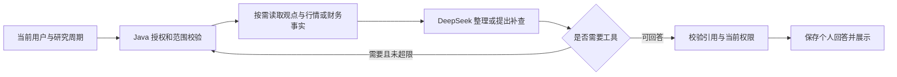

# SPEC-004：单股研究 Agent 设计草案

状态：2026-10-09，AG 要求与 P-001～P-007 使用细则已确认；本文为对应技术设计，具体配置和模型效果须经实验验证，尚未实施、未运行真实模型。本文说明机制，不替代 [需求](requirements.md) 的确认状态。阶段顺序与证据位置见 [任务](tasks.md)。

## 1. 首个页面闭环

在现有单股研究详情中，按用户选择的研究周期打开研究助手面板。优先在周期标题处提供“研究梳理”入口，通过明确的周期 ID 绑定对象，不把页面筛选／已加载记录自动当成 AI 输入范围。结果结构、原文弹窗与个人对话沿 AG-001～AG-019；财报与数据边界沿 AG-020、AG-021，不另建独立聊天首页。

初次梳理由 Java 固定完成范围校验、受限周期资料读取及报价获取，再调用模型整理；报价字段由 Java 直接展示。追问由模型在必要时提出查询，由 Java 执行受限工具并回传，然后校验并保存回答。第一次摘要是固定流程，追问中的受控工具选择另验，不能用摘要成功证明 Agent 已完成。

模型 API、费用、主框架与兼容性只采用 [技术规划](../../architecture/technology-stack.md#32-v2-agent-技术规划基线)；新增包按 [项目结构](../../engineering/project-structure.md) 放在 `com.stock.system.agent`，复用现有登录、Result 返回结构和业务 Service。模型网络请求不处于持有业务锁的数据库事务中。

## 2. 当前代码可复用的条件与缺口

| 现有代码 | 可复用能力 | 本阶段需补的能力 |
| --- | --- | --- |
| [周期响应](../../../src/main/java/com/stock/system/stock/vo/ResearchCycleDetailResponseVO.java)、[观点响应](../../../src/main/java/com/stock/system/stock/vo/StockOpinionResponseVO.java) | 周期起止／状态、作者、观点正文、观察条件、日期和撤回标记 | 形成最少字段的模型输入，不直接序列化整个接口响应 |
| [研究服务](../../../src/main/java/com/stock/system/stock/service/StockResearchLifecycleService.java) | 授权内详情、跨周期时间线、撤回正文隐藏 | 当前时间线固定每批 20 条且没有周期 ID 过滤；新增受限周期读取与单条原文读取能力，校验周期属于该空间股票。不能依靠不断翻完全股票历史来找到一个周期 |
| [行情服务](../../../src/main/java/com/stock/system/stock/service/StockMarketPreviewService.java) | 授权内最新报价、日 K 和分时 | 为模型提供受限适配，复用既有网关与缓存；不新建真实行情连接、不改变本地 SDK／生产 CLI 边界 |
| [历史行情响应](../../../src/main/java/com/stock/system/stock/vo/StockCandlestickSeriesVO.java) | 币种、来源、复权口径、模拟标记、获取时间与序列 | 使用 `day` 与 `adjustment=none` 的实际口径；缺交易日或区间不完整时报告实际覆盖。结束周期没有结束价快照，不能凭最新价还原其结束收益 |
| `pom.xml` 的 Longbridge SDK 4.5.0 与现有 SDK／CLI 网关 | 当前依赖已含 `FundamentalContext` 财报方法；已有服务端授权和传输分工 | 当前 Java 网关未封装财务读取。新增受限财务 Service 与两种适配并先实测字段／覆盖；复用授权与会话，不为财报另建 QuoteContext 或改变开发 SDK／生产 CLI 路径 |
| [研究页面](../../../frontend/src/views/workspace/WorkspaceStockResearchView.vue)、[股票 API](../../../frontend/src/api/stock.ts) | 当前空间／股票、周期卡片、授权请求、迟到响应保护 | 增加独立助手组件和原文弹窗；切对象、退出登录及卸载时清理显示状态，沿用请求版本校验，避免旧结果覆盖新对象 |

以上为代码审查事实，不是新 Agent、模型质量、数据库迁移或真实上游验收证据。

## 3. 读取契约与数据一致性

拟在股票业务层补受限查询，Agent 工具通过公开 Service 调用。当前用户 ID 从认证对象取得，空间、股票和周期绑定会话后由 Java 注入；模型参数不提供可自行变更的用户、空间、周期、任意代码、SQL 或 URL。

周期读取先确认范围、有效记录数量和文字量。允许范围内完整读取，按观点日期与 ID 稳定排序；包含 INITIAL、UPDATE、REVIEW，排除已撤回正文。统计、读取及截止信息需有一致性边界，模型调用前关闭短读事务；交付前再校验当前访问和所读来源。返回 `scope` 由 Java 生成，包含条件、数据截止、总有效条数、读取条数及覆盖状态，不由模型填写。

超限时先返回“需要缩小范围”，不付费生成假装完整的摘要。按用户选定的日期／成员重读时，标题和结论明确该子范围；成员最新观点只代表本次范围内最新可见记录。时间不明确或成员昵称有歧义时先澄清。生成时出现新增观点可保留带时间的结果；撤回／失去权限导致来源无效时，拒绝交付依赖它的答案，提示重新梳理。

初次快照与价格引用绑定同一币种、时间、来源及模拟状态。行情失败转换为受控不可用信息，不吞掉权限错误。历史价差由 Java 使用同一序列的实际日期和 BigDecimal 计算；分母非正、币种／口径／模拟状态不相容时不计算，不将分红／复权影响或名义变化包装成投资回报。

### 3.1 模型输入与结果校验

研究输入只取需求 P-007 所需字段；显示作者与来源引用映射由 Java 保存。模型不接收 LoginUser、用户认证资料、邀请码、完整业务对象或内部执行权限。用户输入与资料正文作为待分析内容，不允许其中的文字修改工具清单、读取范围或权限。

初次模型结果拟分为 `overview`、`changes`、`members`、`pendingItems`；条目携带本次返回资料中的引用标识。`quote`、`scope`、作者展示映射与生成时间由 Java 组成，不由模型生成。追问使用正文段落与引用的结构，允许简短回答，无需反复输出三块摘要。

来源使用类型区分观点、行情和财务快照。财务标识由 Java 绑定本次取得的科目与期间，不能伪造为 opinionId；数值、单位、报告期和比较结果从受控 DTO 取，模型负责解释和组织。查看财务依据时展示生成时实际使用的快照；有经过核验的供应商／披露链接才提供跳转，不由模型生成 URL，不将供应商结构化数据假称为已读发行人原始 PDF。查看及恢复仍校验当前对象权限。

Java 校验字段类型／长度、合法引用、对象归属与当前访问；核对成员比较采用的记录是否符合范围内最新规则。引用 ID 存在不代表语义支持正确，判断变化、理由和事实边界仍需固定问题集与人工核对。空结果、截断、错误对象、未知引用及不可解析结果不展示为完成答案。前端优先按结构渲染文本，不执行模型返回的 HTML 或脚本。

## 4. 首批工具适配

小实验只有一个受控观点工具；V2 第一版完整主体按 AG-020 逐步具备下列四个只读工具，均未实现。财务数据源先做小验证，首次研究＋报价页面可以先展示，完整首版不能以财报尚未接入的状态验收。初次梳理不默认拉取全部报表，财报工具由具体追问按需触发；通用概念解释、成员观点与已取得财务事实分清。

| 拟用工具 | 模型可选参数 | Java 返回与校验 |
| --- | --- | --- |
| `read_cycle_opinions` | 可选作者标识、开始／结束日期 | 固定当前研究对象；作者须来自可读取范围，日期须合法，完整／超限状态和来源标识由读取 Service 返回；不返回撤回正文 |
| `read_latest_quote` | 无研究对象参数 | 查询该股票最新可用报价，返回后端快照及时间／来源；当前价格问题须用本次获取的快照，不能把历史聊天中的价格标成现在 |
| `read_daily_prices` | 开始／结束日期 | 仅同一股票日 K，范围与条数受限；查询上游后按实际日期过滤，返回实际覆盖、复权口径、来源与 Java 计算的名义变化。上游最少 20 条与内部有界多取需适配，不能直接传入小于现有 Service 下限的 count |
| `read_financial_facts` | 白名单财务指标、报告期类型、可选明确财政年度 | 股票由 Java 绑定；按已经验证的市场／科目映射读取有限期间，返回真实数字、科目口径、币种／单位、报告期、来源／获取时间、覆盖与缺失状态。同口径计算由 Java 完成；年度／季度／累计不能混比，未知字段、期间或越界查询拒绝 |

已有资料足够时可直接回答，不为展示“Agent”强制查询。所有模型请求中的工具名和参数都经白名单校验；同一请求可能提出多工具，额度按实际调用逐个计数。拒绝的调用也有对应错误结果，保持 tool_call_id 配对，不把失败描述成查询成功。限制达到后终止补查，说明未完成范围。

普通工具参数校验与最终回答 DTO 校验分开。小实验须核对工具调用与 JSON 输出组合；组合不适用时分成工具选择和无工具结构化作答，仍计入同一请求额度，不依赖 Beta strict 模式。具体接口依据见 [模型接入安排](../../architecture/technology-stack.md#35-首轮模型与费用安排)。

### 4.1 股票数据覆盖与接入状态

2026-10-09 核查。表中“平台有接口”只表示官方列出能力，不表示当前账号、每只股票、每个市场和每个历史期间已验收；“Java 已有”指 V1 数据链路，不代表 Agent 已完成。此表维护数据边界，其他文档只引用，不将未列字段默认为可查或绝对不可查。

| 数据类别与代表问题 | 来源能力与限制 | 当前 Java 项目 | V2 第一版安排 |
| --- | --- | --- | --- |
| 本空间研究：谁何时改观点、共识／分歧 | 自有 MySQL；只读当前权限内且未撤回的观点 | 已有研究／时间线，需补周期受限读取 | 必做 |
| 股票身份：代码、名称、市场、币种、交易状态 | 已有可信目录及交易状态核实；查到代码不等于能取得全部数据 | 已接入；无价格状态与核实时间可单独返回 | 作为所有工具的对象依据 |
| 最新价格：当前最新可用价、何时报价 | [行情接口](https://open.longbridge.com/zh-CN/docs/quote/overview) 可查，实时性取决于 OpenAPI 权限与数据时间 | 已接入 lastDone、时间、来源等；不能由 SDK 更丰富响应推断项目已暴露全部字段 | 必做，首次结果默认展示 |
| 历史行情：日开高低收、成交量／成交额、短期名义变化 | 同上支持 K 线／历史，实际跨度、复权与标的额度有边界 | 已有 OHLC、volume、turnover 和历史读取 | 必做有界日 K；不承诺任意长历史或完整投资回报 |
| 分时及技术指标：今天分时、均线／MACD | 同上有分时；技术指标需明确定义和行情序列计算 | 分时已接 V1；Agent 分时工具、MA／MACD 尚未接入 | 分时／技术指标不自动列入首版工具；可后续复用／计算 |
| 核心财报：营收、净利润、资产／负债、经营现金流及同比 | [财报 API](https://open.longbridge.com/zh-CN/docs/fundamental/fundamental/financial-report) 支持三表；[CLI 文档](https://open.longbridge.com/zh-CN/docs/cli/fundamentals/financial-report) 有港股／美股路径及账号路由区别，A 股实际字段覆盖尚未验证 | SDK 已含能力；Java 财务 Service／适配尚未实现，未取得本轮真实响应 | 新增必做；先验 A／港样本，再限定已验证科目／期间 |
| 估值：PE／PB／PS、市值、估值历史 | [估值接口](https://open.longbridge.com/zh-CN/docs/cli/fundamentals/valuation) 有相应能力，指标口径／时点和覆盖仍需核对 | 尚未接入，不能由最新价单独算出全部估值 | 后续候选；核心财报不自动等于估值工具 |
| 公司经营：行业／主营、业务收入构成、分红 | [基本面概览](https://open.longbridge.com/docs/fundamental/overview)、[业务分部](https://open.longbridge.com/zh-CN/docs/cli/fundamentals/business-segments) 列出能力，细分科目依标的而异 | 尚未接入 | 后续候选，不承诺每家公司都有完整细分数据 |
| 新闻：最近报道、标题／发布时间／正文 | [资讯接口](https://open.longbridge.com/zh-CN/docs/cli/content/news) 有按股票读取与文章详情；不代表全网完整覆盖 | 尚未接入 | 后续候选；不能以模型知识冒充刚查到的新闻 |
| 公告／财报原文：公告说了什么、管理层为何解释增长 | [文件接口](https://open.longbridge.com/zh-CN/docs/cli/content/filing) 明列美股 SEC 与港股披露；该页不能证明 A 股公告覆盖；正文、附件可读性另验 | 尚未接入；结构化财报数字不包含任意全文／附注 | 后续评估原文来源或小型 RAG；首版不假称已读全文 |
| 盘口／逐笔／资金流、股东／机构持仓 | [行情概览](https://open.longbridge.com/zh-CN/docs/quote/overview)、[基本面概览](https://open.longbridge.com/docs/fundamental/overview) 有相关接口；部分受付费级别、市场及披露频率限制 | 尚未接入 | 后续候选；席位／资金统计不能当成交易者真实意图 |
| 评级／目标价／盈利预测、指数成分／宏观日历 | [基本面概览](https://open.longbridge.com/docs/fundamental/overview) 与 [官方更新](https://open.longbridge.com/docs/changelog) 列出能力 | 尚未接入 | 后续候选；预测须标机构、日期和预测性质，不能当作未来实际结果 |
| 用户证券账户持仓／盈亏／订单 | [账户接口](https://open.longbridge.com/docs/cli/account/portfolio) 需账户权限；网站共享关注不等于券商持仓 | 未接券商账户，不取得其他成员资产 | 非本阶段范围；不自动交易 |
| 未公开业绩、内幕、未来确定股价／真实主力意图 | 未公开或未来事实没有可供可靠查询的已知结果；报道、预测与推断不能变成确定事实 | 无此事实查询能力 | 明确不能保证；允许基于已读材料提出带条件的推断 |

同一数据类别的失败须区分：项目未接入、来源未覆盖该市场／标的／期间、科目缺失、账号无权限、超时／接口故障、事实尚未知。已取得部分可以回答并列缺口；不可用不能变成零值。用户自由提问不等于自由访问任何数据源，实际可用工具与覆盖由 Java 决定。

行情时效的官方边界：OpenAPI 权限与手机客户端／PC／网页端独立；基础权限列出美／A 股报价及港股 BMP 约 15 分钟延迟，港股实时及 LV2 另有权限要求。本轮没有查看用户实际订阅，不能据此断言其港股报价具体延迟。项目以授权及真实时间说明最新可用数据，不将“实时信息”作为所有类别的统一承诺。财报按披露更新，股东数据按披露期更新，均不同于盘口时效。

### 4.2 财报查询的边界与来源

首批科目以营收、明确口径的净利润、总资产、总负债、经营活动现金流为主；EPS／利润率只在对应映射和单位已验证时加入。输入初值最多 8 项、一个目标报告期加一个同口径可比期。返回可用报告期及缺失项；用户指定未覆盖期间时说明，不能悄悄用别的期间。最新问题查询数据源最新可用期并明确这种范围，未核实披露日／源端更新完整性时不称最新已发布完整报告。完整三表明细、所有历史、附注、扫描 PDF 和任意用户上传不作首批前置。

财务 DTO 除数字还带源字段及显示名称、利润口径、期间类型／结束日、币种、数值单位、来源标识、获取时间和比较依据；来源有发布日期才记录，没有则明确未知。`fp_end` 是报告期结束，不能映射为发布日期；仅有 currency 也不能猜测金额是元、千元或百万元。科目 mapping 依据真实响应和官方定义建立白名单，归母净利润不自动映射为任意 net income；非通用行业科目或含义不清时先返回不支持。

比较使用同公司、同币种／单位、同利润口径和同期间类型；同比／绝对变化由 Java BigDecimal 计算。基期为零或负数等不适合普通增长率的情形说明绝对变化及原因，不硬给常规百分比。可比期缺失不算同比，不拿全年数与单季或累计数比较，不推断增长必由某业务原因造成。读取结果不足以证明成员全部结论时限定为已核对的这一项。

财务读取独立于报价故障，按股票业务 Service 组织，可复用短缓存；对“现在最新”保留获取时间与缓存来源，不悄悄用聊天旧数字。工具入口继续确认当前空间及股票权限。早期真实数据预检无需模型、数据库写入或额外行情连接，运行条件按测试规则核对；预检不通过先核对身份／权限／期间并评估官方公开披露或另一合法来源。新的付费服务、账号授权或全文解析另定，不把假数据替代真实数据来宣布财报完成，也不等全文路径验证才展示研究＋报价里程碑。

### 4.3 接口与本地依赖核查

2026-10-09 已离线检查 `openapi-sdk-4.5.0.jar`：有 `com.longbridge.fundamental.FundamentalContext`，实际签名为 `getFinancialReport(String, FinancialReportOptions)`。官方页面中的无 options Java 简例与当前依赖签名不同，实施以已用依赖的类型和编译结果为准，无需仅为方法存在而升级 SDK。

本机 CLI 0.28.7 的 `financial-report --help`／`financial-statement --help` 和 schema 已检查，均非真实数据查询。financial-report 的 kind／latest 适用于 AP 路径，US 数据中心有不同路由；不能把账号地区和证券所属市场混为一谈。当前 financial-statement help 的 kind 默认是 IS，而网页示例称不传等于 ALL，实施必须显式传所需类型并核对结果。

开发侧拟复用 SDK 管理的 OAuth／Config 创建财务上下文，按现有会话关闭生命周期处理；生产侧拟在既有 CLI 管理器中封装财务读取。当前 [serve 文档](https://open.longbridge.com/zh-CN/docs/cli/serve) 与本机 `serve --help` 均列出 `api.get`／`api.post` 作为基本面等 REST 接口入口；财务适配只允许 Java 固定的只读端点与参数，不能把任意路径／URL／写接口透传给模型。常驻服务复用连接，一次性命令可能重复初始化，本轮没有为试查另起真实 CLI／SDK 行情连接。财务端点的实际路由／响应、源字段与 A／港样本尚未运行核对，不能把帮助或类签名当作上线可用证据。

## 5. 调用、费用和失败限制

以下为实验及首个闭环的配置初值，待样本实测后锁定；放宽输入、调用或并发前重新评估费用与响应时间，不由模型决定。

| 项目 | 拟用初值与行为 |
| --- | --- |
| 周期资料 | 最多 100 条有效观点、理由及观察条件合计最多 20,000 个 Unicode 字符；同时受整个请求大小约束，不能承诺任意 100 条必然装得下 |
| 历史行情 | 区间不超过 31 个自然日，一次最多向上游获取 60 条日 K 后筛选；返回实际交易日，不能将非交易日补成假价格 |
| 财务资料 | 最多 8 项已验证指标、目标期和一个同口径可比期；若上游返回更多历史，仅将本次需要的有界结果送给模型，上游请求量和时限仍需限制 |
| 会话上下文 | 从最近 6 轮有效完整问答起取，整轮缩减并说明未携带全部聊天历史；不自动调用模型压缩。指代缺必要上下文时澄清，旧资料须重新读取 |
| 请求输入与输出 | 序列化请求体初始限制 64 KiB UTF-8 字节，模型 max_tokens 初始 2,000；字节上限用于程序保护，不当作准确 Token 计费量，允许基于质量结果调整输出上限 |
| 执行次数 | 小实验及最早页面每个提问最多 3 次模型请求、2 次模型提出的工具执行；接财报后的完整主体初值最多 4 次模型请求、3 次工具执行，以允许研究＋报价＋财报组合，仍须实测并受同一预算约束。初次固定的资料与报价读取另记，并同样受数据、总时限与权限限制；预算和计数必须在调用前检查 |
| 时限 | 每轮总时限初始 60 秒，网络请求限时不得超过剩余时间；记录超时阶段，迟到结果不得完成或覆盖新对象 |
| 并发与重试 | 小实验单请求串行；首个页面同一用户最多一轮生成，总并发初值 2。不自动付费重跑，不对相同 requestId 重复执行；限流反馈保留输入 |
| 实验预算 | 从技术栈的首轮上限读取；先预留本次请求可能的最高费用，再按真实用量结算。估算不准时不能假称硬上限，需使用模型声明的最大输入／受控输出与较高单价作保守预留；超时等用量不明时继续占用预留，直到核对，不立即释放给下一次调用 |

这些数值是项目初值，不是招聘门槛或已测性能。输入过长时先缩小研究资料或减少历史上下文；不默默截断某条观点正文。结构正确而内容错误仍算质量问题。无权限不自动重试，额度不足不切换付费模型，报价暂不可用不阻塞已有观点整理；业务／模型错误对用户使用可理解的原因，不显示密钥、内部提示词或原始供应商错误堆栈。

## 6. 个人记录、接口与页面状态

### 6.1 保存与撤回处理

简易个人对话保存与主动清空策略按已确认的 AG-015、AG-016、AG-019 执行。以下持久化、撤回与接口机制仍为技术草案，实际迁移及实现尚未执行。

MySQL 为持久化首选；候选关系是 `agent_session` 管理用户＋空间＋股票＋周期的唯一上下文，`agent_message` 保存问答及生成时范围，`agent_run` 保存请求 ID、状态、依赖来源、工具／模型版本、时长与用量。这里只说明待采用关系，实际字段、索引和迁移在实施时按 [数据模型](../../architecture/data-model.md) 与 Flyway 维护，当前未建表。

保存回答时记录实际输入资料依赖，包含承接历史问答的依赖，而不只保存最终文案中出现的引用。返回历史、构造新上下文和打开原文时批量核对这些依赖及当前权限；受撤回影响的回答提示需重新梳理，不返还原正文，不再进入模型消息。依赖集合也须有界，超限时少带历史或开始新的上下文，不无限继承整段聊天。失去空间读取权限时不返回该对象的个人消息；页面收到权限失效清空对应显示，不能承诺已发送到客户端的文本能远程收回。

按 AG-019，聊天不默认定期删除；用户明确清空当前对象时删除其问答、引用快照与正文，不删共享研究数据。必要调用用量与预算占用独立保留，明细保留期限在上线前定，不保存原始完整提示词／思考内容。生成中先处理运行状态；利用上下文版本和终态检查防止清空后的迟到答案重新出现。

### 6.2 API 草案

路径统一绑定空间、空间股票和周期，例如基础路径 `/api/workspaces/{workspaceId}/stocks/{workspaceStockId}/research/cycles/{cycleId}/agent`。均使用现有认证与 Result 格式，登录用户由服务端取得，不接受 callerUserId。

| 操作 | 拟用接口与关键契约 |
| --- | --- |
| 恢复个人记录 | GET 基础路径；无会话返回空记录，不因 GET 自动创建。消息有界分页，返回当前有效回答及生成状态 |
| 首次／重新梳理 | POST 基础路径下 `/summaries`，携带 requestId 与明确的读取条件；相同 ID／相同内容复用运行结果，不重复计费，相同 ID 换内容拒绝 |
| 继续追问 | POST `/messages`，携带 requestId 和提问；相同用户同时生成时返回现运行状态／忙碌提示，不另起一次付费任务 |
| 恢复进行中状态 | GET `/runs/{runId}`；核对运行属于当前用户与对象，轮询只查本地状态，不重发模型请求 |
| 查看原文 | GET 当前周期下 `/opinions/{opinionId}`；在股票业务层新增受限读取，校验归属及撤回，不依赖浏览器缓存的旧正文 |
| 清空个人对话 | DELETE 基础路径；仅当前用户该对象，进行中先处理运行终态；消息删除与版本更新短事务完成，不能重置费用账本 |

首个可用页面可以用有界同步生成＋状态读取，不引入 MQ 或长期后台任务。网络断开不表示服务端已停止或供应商未计费；恢复时查询运行，手动重试使用新 requestId。临时断网与真正无权限分开处理，不错误清空登录状态。

### 6.3 用户看到的状态

待使用、读取资料、整理中、完成、资料超限、失败／超时、无权限分别有明确反馈。生成按钮锁定，输入问题在失败后保留；已有有效回答不被一次失败替换。股票／周期切换后只展示该对象消息，关闭原文弹窗保留输入和聊天位置。旧结果标读取范围与日期，检查到新资料时显示“重新梳理”入口，不自动调用模型。

SSE 在同步闭环后单独实施，使用带认证头的 fetch 流或对应客户端，处理取消、事件归属与迟到消息。工具参数、原始 JSON 和模型思考内容不作为用户进度；结构化段落与引用校验后再交付，未完成内容不能入库为完成结果。逐段／逐字展示、部分结果及取消的真实行为需额外验收，未验收前不标已接入。

## 7. 最早实验与退出路径

先用独立 Java 17 HTTP 程序验证，无 Spring 启动、数据库或真实行情连接；具体 DeepSeek 型号、模式、地址与预算见技术栈。使用自造的两成员观点、判断变更、零／单条、撤回和缺公告样本；报价固定并明确模拟，由 Java 组成结果。

第一步验证直接资料输入的结构化梳理；第二步加入一个受限观点工具，检查需要补查、已有资料可直接回答、无效工具／参数拒绝及停止过程。同一代表问题重复三次，保存必要运行摘要与人工核对结果，不以回答措辞完全相同作为正确标准。程序边界、实际模型行为与最终任务质量分别判断。

未通过时先减少输入或调整契约／提示，再对照另一模型；仍不稳定则只保留已过的摘要能力，工具选择记为未通过，不能宣布主体完成。框架迁移在隔离副本另验，避免在看见模型能力之前升级整个主项目。小实验用的是替身资料，不能代替正式权限、周期分页、实时行情、持久化和浏览器验收。

首轮试验的问题与后续任务见任务文件。财务来源预检尽早独立进行；最早可见闭环后补齐财务工具，再完成 SSE 和第一版质量回归。财报属于完整首版，观察条件、空间简报、RAG／MCP 与外部金融授权保持原路线，不进入小实验的实现前提。
